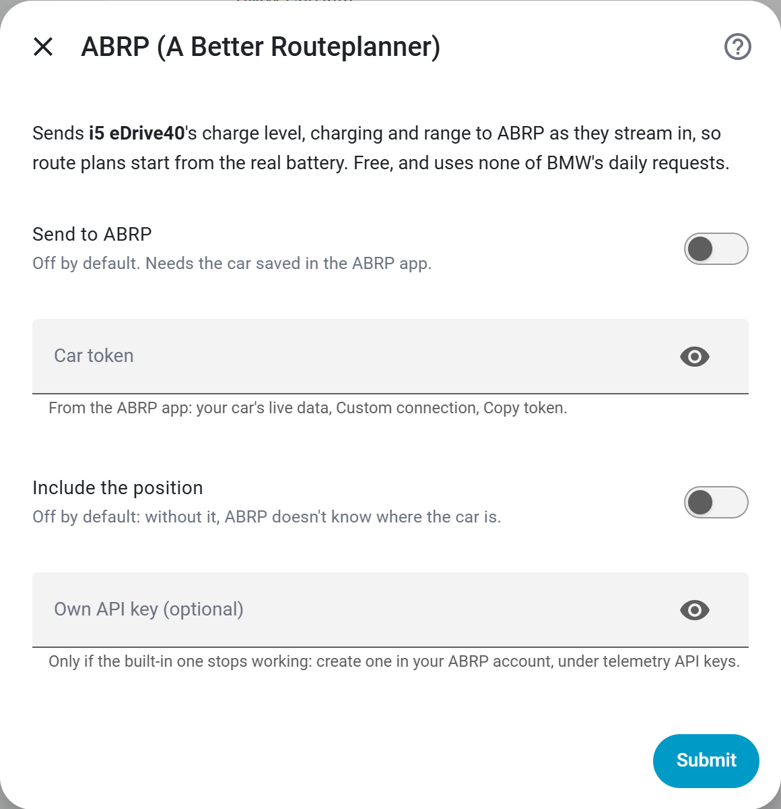

# ABRP live data: your BMW's battery in A Better Routeplanner

> 🇩🇪 [Deutsch](DE-Feature-ABRP)

[ABRP (A Better Routeplanner)](https://abetterrouteplanner.com) plans a trip
around charging stops. It starts from a guessed battery level unless something
tells it the real one. BavarianData can be that something: it sends your BMW's or
MINI's live state from BMW CarData to ABRP, so a plan starts from the actual
charge level, and ABRP replans as the battery drains on the way.

- **Free.** It works with a free ABRP account. ABRP Premium is not needed.
- **No API quota.** It runs off BMW's live stream, not the
  [50 requests a day](Feature-API-Quota).
- **Off by default, per car.** Nothing leaves Home Assistant until you switch it
  on for a car.

## What ABRP gets

| ABRP shows | From |
| --- | --- |
| Charge level (SoC) | The same figure the card shows, which [keeps counting while the car charges](Feature-State-of-Charge) even when BMW goes quiet |
| Charging, and whether at a DC fast charger | BMW's charging status and charging method |
| Charging power | BMW's charging power |
| Parked or driving | BMW's motion signal, or BavarianData's [trip detection](Feature-Trips) |
| Odometer and range | BMW's mileage and electric range |
| Position and altitude | Only with **Include the position** switched on |

A value the car hasn't reported is left out, never sent as zero. With no charge
level at all, nothing is sent. BMW's stream can be quiet for hours on a parked
car, so the last known values are repeated every 30 seconds. That keeps ABRP from
dropping the car as offline.

## Set it up

1. **In the ABRP app:** save your car and open it, then go to **Live data →
   Custom connection** and tap **Copy token** under *Generic token*. A car that
   already has a connection opens its live data instead: tap **Edit** there first.
2. **In Home Assistant:** go to **Settings → Devices & services → BavarianData →
   Configure → Share live data → ABRP (A Better Routeplanner)**. With more than
   one car, pick the car first.
3. Switch on **Send to ABRP**, paste the token into **Car token** and press
   **Submit**. The token is checked with ABRP straight away. A token ABRP refuses
   is said on the screen, not only in the log.

Within a minute, the ABRP app shows the car's live data with the source **API**.

  

Every field is described in the
[settings reference](Settings-Reference#abrp-a-better-routeplanner).

## Questions

### ABRP asks for Premium before it gives me a token

A free ABRP account holds **one** saved car. With a second car saved, the app
asks for Premium before it gives out a live-data token. Remove the other car, or
use one ABRP account per car.

### Does ABRP see where the car is?

Only if you switch on **Include the position**, which is off by default. Without
it, ABRP gets the battery, charging and odometer, but no location from
BavarianData.

### Two cars

Each car has its own token and its own switches; a car added later doesn't
inherit them. See [multiple cars](Feature-Multiple-Cars-and-Accounts).

### Nothing arrives in ABRP

- The log says *ABRP refused the car token or the API key*: copy the token
  again from the app, as in step 1.
- The car has never reported a charge level since Home Assistant started: then
  there is nothing to send yet. The next reading starts it.
- Releases carry BavarianData's own ABRP API key. If ABRP ever stops accepting
  it, create your own key in your ABRP account, under telemetry API keys, and
  enter it in **Own API key (optional)**.

### Is this the same as ABRP's own BMW connection?

No. BavarianData sends what your Home Assistant receives from BMW CarData, with
your own client ID. No other server sits between BMW and Home Assistant, and ABRP
receives only the values in the table above.
