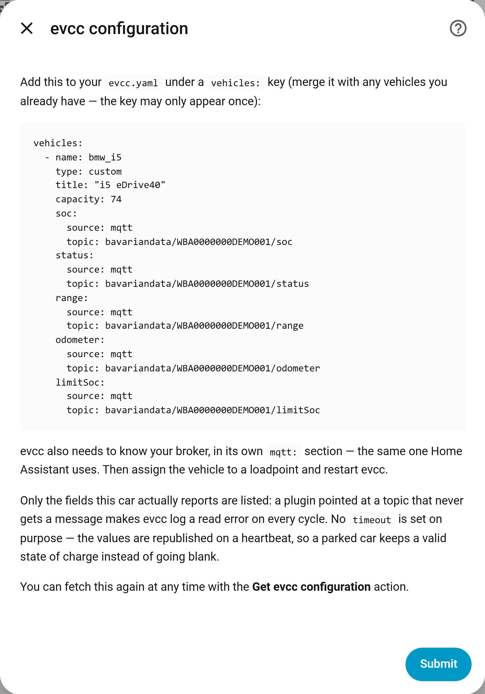

# MQTT bridge (evcc & more)

> 🇩🇪 [Deutsch](DE-Feature-evcc-and-Wallbox-Bridge)

BMW gives each account **one live stream**, and only one program can hold it.
The bridge lets BavarianData hold it and hand the car's data, over your own MQTT
broker, to everything else that wants it: evcc, openWB, Node-RED, a MagicMirror,
a script. None of them needs a BMW login of its own, and none of it costs
[API quota](Feature-API-Quota).

It works in both directions:

- **Out:** the car's [state of charge for evcc](#outbound-the-cars-state-of-charge-for-evcc),
  and the car's [whole stream](#sharing-the-whole-stream-with-other-apps) for any
  other app.
- **In:** your [wallbox's own meter](#inbound-your-wallboxs-meter-for-the-charging-history)
  tells the [charging history](Feature-Charging-History-and-Cost) exactly what
  each charge drew from the grid.

---

## One stream per account

<a id="one-stream-per-account"></a>

BMW CarData allows **one stream connection per account** at a time. The program
that has it keeps it, and BMW turns every other one away with *not authorized*
(MQTT rc=5), the same answer a wrong login gets. The stream changes hands only
when its holder lets go, and every program does that at least once an hour to
renew its login. So two programs take turns: whichever reconnects first gets the
stream, and the other is locked out until the next gap. Both miss data, and
neither tells you why. What you see:

- values in Home Assistant stop updating for minutes or hours, then catch up;
- the connection sensor shows the stream as not connected for long stretches;
- evcc's state of charge freezes or goes missing in the middle of a charge.

BavarianData recognizes the case: when BMW refuses the stream although a freshly
renewed login works, it tries again every few minutes, and after half an hour the
repair **Another program holds the BMW stream** appears under
**Settings → Repairs**.

The usual suspects are **evcc's own BMW CarData vehicle** (`template: cardata`
with no `broker:`), a second CarData integration in Home Assistant, an ioBroker
or openHAB adapter, a MagicMirror module, a Garmin widget or a stream collector.
Each of them opens its own stream on your account.

**The fix is to give the stream to one program and share it.** BavarianData
holds it, and the bridge puts the car's data on the MQTT broker Home Assistant
already uses. The other programs read it from there:

| You also use | Do this |
| --- | --- |
| **evcc** | Tick **Publish this car for evcc** and paste the block it generates ([setting it up](#setting-it-up)). evcc then needs no BMW login and spends no requests. This is the recommended way. |
| **evcc's own BMW CarData vehicle** (`template: cardata`) | Point it at the shared stream rather than at BMW: see [evcc's own CarData vehicle](#evccs-own-cardata-vehicle). |
| **openWB**, **Node-RED**, a script | Read the evcc topics (`soc`, `status`, `state`…) or the [shared stream's](#sharing-the-whole-stream-with-other-apps) per-field topics. |
| A tool that reads **BMW's own messages** (MagicMirror, Garmin, Grafana, a collector) | Tick **Share this car's whole stream** and set the tool's topic to `<prefix>/+/stream`. A tool with a fixed topic can't be pointed at it. |
| A **second CarData integration** in Home Assistant | Not possible on the same account. Pick one. |

The 50 daily [API requests](Feature-API-Quota) are counted per account too, so a
second program that still asks BMW directly spends from the same 50.

---

## Outbound: the car's state of charge, for evcc

### Why this is worth doing

evcc and openWB can ask BMW for the car's state themselves. Either they poll
BMW's API on a timer, which is limited to 50 requests a day per account, or they
open the account's [one stream](#one-stream-per-account), which Home Assistant
then can't have while they hold it.

BavarianData already holds the stream. The state of charge arrives as the car
reports it and costs **none** of your
[50 daily API requests](Feature-API-Quota). Handing that to evcc gives it a
live state of charge without a second connection to BMW.

That's what this bridge does: it republishes what we already know onto your own
MQTT broker, in the layout evcc's `custom` vehicle expects.

### Setting it up

**Prerequisite:** the **MQTT integration** must be set up in Home Assistant
(*Settings → Devices & services*). The bridge publishes through it, which is why
there's no broker host or password to enter here — it lands on exactly the
broker Home Assistant is already connected to, which for almost everyone is the
same one evcc reads.

1. **Configure** → **Share live data** → **MQTT bridge (evcc & more)**
2. Tick **Publish this car for evcc**. Leave the topic prefix and **Publish
   retained** alone unless you have a reason.
3. The next screen hands you the **evcc configuration**, already filled in with
   your VIN, your prefix and your car's pack size. Copy it.
4. Paste it into your `evcc.yaml` under `vehicles:` — merging it with any
   vehicles you already have, since the key may only appear once.
5. Make sure evcc's own `mqtt:` section points at the same broker, assign the
   vehicle to a loadpoint, and restart evcc.

<p align="center">
  
</p>

You can fetch that configuration again at any time with the
[`get_evcc_config`](Services-Reference#get_evcc_config) action, which also tells
you which topics are currently live.

### What gets published

Everything under `<prefix>/<VIN>/`, with `bavariandata` as the default prefix:

| Topic | What it is | Used by evcc as |
| --- | --- | --- |
| `soc` | State of charge, % | `soc` |
| `status` | `A` unplugged, `B` plugged, `C` charging; `ErrNotAvailable` while plugged in [away from home](#away-from-home-the-status-is-withheld) | `status` |
| `range` | BMW's own remaining electric range, km | `range` |
| `odometer` | Odometer, km | `odometer` |
| `limitSoc` | The car's own charge target, % | `limitSoc` |
| `chargePower` | Charging power, kW | — |
| `plugged` / `charging` | `true` / `false` | — |
| `updated` | When BMW last *measured* the state of charge (ISO 8601) | — |
| `state` | All of the above as one JSON document | — |

`chargePower`, `plugged`, `charging`, `updated` and `state` aren't used by evcc.
They're there for openWB's MQTT SoC module, Node-RED flows, and for looking at
in MQTT Explorer when something isn't working.

### Away from home, the status is withheld

evcc reads a car's `status` for one thing: when a car plugs into a loadpoint and
the wallbox can't say which car it is, evcc picks the vehicle reporting `B` or
`C`. A car plugged in at a public charger reports exactly that, so a guest's car
at your wallbox could be taken for it, with its state of charge and charge
target.

So while the car is plugged in somewhere the integration knows is outside your
Home zone, `status` reads `ErrNotAvailable`. That is evcc's own word for "no
value", and evcc then leaves the car out without logging an error. An
unplugged car still reports `A`, and `plugged`, `charging` and the `state`
document keep the real values; `state` also carries `"away": true`. A car that
reports no position at all is treated as at home.

### Three things it does deliberately

**Anything the car doesn't report isn't published.** Not published as zero —
simply absent. A charge controller *acts* on these numbers: told `soc: 0` it
charges a full battery, and told `status: A` ("no vehicle connected") an
identifying charger can stop charging the car it's plugged into. So a car that
reports no plug state gets no `status` topic, and evcc falls back
to its own handling instead of being misled. If a value later becomes unknown
again, its topic is removed rather than left showing last week's reading.

**Everything is re-sent every five minutes, unchanged.** A parked car streams
nothing for days, and its state of charge is no less true for that. evcc's
plugins treat a value that stops arriving as stale, so the generated
configuration deliberately sets **no `timeout`** and the bridge keeps the values
fresh on the broker instead.

**Switching the bridge off removes what it published.** Retained messages
outlive Home Assistant by design — that's what lets evcc find the state of
charge the instant it starts. It also means that just stopping wouldn't be
enough: a broker would go on serving a state of charge that never updates again,
with evcc unable to tell. So clearing the checkbox clears the topics. (A
restart, reload or upgrade does *not* — the last value we knew is still the
truth for those few seconds.)

### The state of charge it publishes

The same figure the card and the **State Of Charge (Predicted on Integration
side)** sensor show: BMW's last reading, extrapolated forward while charging
from the charging power — or from your
[wallbox meter](#it-also-drives-the-state-of-charge-estimate), once one is bound
and has learned. evcc and your dashboard can never disagree about the
percentage. The `updated` topic carries when BMW last actually *measured* it, so
you can see how old the underlying reading is.

### Multiple cars, multiple accounts

Each vehicle gets its own topic subtree keyed on its VIN, and the generated
configuration lists every car the entry knows about under a single `vehicles:`
key.

### evcc's own CarData vehicle

<a id="evccs-own-cardata-vehicle"></a>

evcc has its own BMW/MINI vehicle, `template: cardata`. Left as it comes, it
opens the account's stream itself, and evcc and Home Assistant take turns
locking each other out. If you prefer it to the generated `custom` block, give it
the stream BavarianData shares instead:

1. In the bridge, tick **Share this car's whole stream**.
2. In evcc's vehicle, set `broker` (and `user`/`password` if your broker needs
   them) to the broker Home Assistant publishes to, and `topic` to the shared
   stream:

```yaml
vehicles:
  - name: bmw
    type: template
    template: cardata
    vin: WBA...                  # your VIN
    clientid: ...                # your CarData client ID
    capacity: 81                 # kWh
    broker: 192.168.1.10:1883    # the broker Home Assistant's MQTT integration uses
    topic: bavariandata/+/stream # <prefix>/+/stream if you changed the prefix
    cache: 2h
```

evcc reads the messages on that topic and picks out its car by the VIN inside
each one, so one topic serves several cars. Leave `broker` empty and evcc
connects to BMW itself again.

Things to know about this way:

- **Signing in to BMW in evcc is optional.** evcc wants a `clientid` in its
  configuration, but it reads the shared stream without a sign-in and then asks
  BMW for nothing. If you do sign in, evcc also asks BMW's API whenever no
  stream message has arrived for `cache` (30 minutes by default), and every
  request comes out of the same [50 a day](Feature-API-Quota) as
  BavarianData's. A parked car sends nothing, so set `cache` to a few hours.
- **After evcc restarts, it knows nothing until the car sends again.** It reads
  only the messages as they arrive, not the retained per-field topics, and a
  parked car can stay silent for hours.
- **Leave out the position** (on by default) also hides the position from evcc.

The generated `custom` block has none of these catches: it needs no BMW
sign-in, and its values are retained and re-sent every five minutes, so evcc
finds them the moment it starts. That's why it's the recommended way.

Tested with evcc 0.319.0: with the configuration above and no BMW sign-in, evcc
read the state of charge and the charge target from the shared stream.

---

## Sharing the whole stream, with other apps

BMW allows [one stream per account](#one-stream-per-account), and BavarianData
holds it. A MagicMirror module, a Garmin widget or a script written against
BMW's own format would need a stream of its own, and only one of them can
have it at a time. Sharing the stream is the way round that: every value
BMW streams for the car goes on the same broker the evcc topics use, as it
arrives. It costs no [API requests](Feature-API-Quota).

**Configure → Share live data → MQTT bridge (evcc & more)** → tick **Share this car's whole
stream**. It's off by default and set per car, like the evcc switch, and the two
are independent: a car can share its stream without being published for evcc.
It needs the MQTT integration too.

Two shapes, under the same prefix:

| Topic | Retained | Payload |
| --- | --- | --- |
| `<prefix>/<VIN>/stream` | never | Each message exactly as BMW sent it: `vin`, `timestamp`, and a `data` block with only the values that just changed. |
| `<prefix>/<VIN>/stream/<field>` | per **Publish retained** | One topic per value, in BMW's shape: `{"value": 72, "unit": "%", "timestamp": "…"}`. `<field>` is BMW's own name, such as `vehicle.drivetrain.batteryManagement.header`. |

Subscribe to the first if your tool already reads BMW's messages, to the second
(or `<prefix>/<VIN>/stream/#`) if it just wants the latest value of each field.
The message itself is never retained because it only holds what changed, so a
late subscriber would take a fragment for the whole car. The field topics are
retained, so a dashboard that starts later finds the car waiting.

A car shares only what its **Data Selection** in the BMW portal streams; see
[Choose your data](Getting-Started-4-Choose-Data).

**The position stays home.** **Leave out the position** (on by default, under
*All vehicles* with several cars) keeps the car's location and its navigation
destination out of both shapes. Turn it off only if an app needs them; turning
it back on removes the position topics from the broker.

**Switching sharing off removes what it published.** BavarianData asks the
broker which shared-stream topics it still holds and deletes them, for that car,
or for every car once the last one is off. That works after a restart too, and
when the integration or a car is deleted.

---

## Inbound: your wallbox's meter, for the charging history

Energy from the stream is measured **at the battery**, so it's below what the
grid actually delivered — the difference is the charging losses. If your wallbox
exposes a cumulative energy sensor in Home Assistant, BavarianData can use that
exact figure instead of estimating.

**Configure** → **Charging costs & history** → **Wallbox energy sensor**.

Pick the wallbox's **total** energy sensor — the lifetime counter that only ever
goes up (`state_class: total_increasing`), not a per-session one that resets.
Wh, kWh and MWh are all handled.

What it changes, once bound:

- Each session records a measured **`grid_kwh`** alongside the battery-side
  figure, and the monthly energy totals, the statistics and the CSV export all
  use the measured one where it exists.
- **Cost is billed from the meter's own advance**, sampled as the charge
  proceeds — so a dynamic tariff still prices each kilowatt-hour at the rate in
  force when it was delivered.
- The **charging loss** on the
  [efficiency view](Feature-Efficiency-and-Range) becomes measured rather than
  assumed — when the meter reads above our battery-side figure. Our figure can
  run a little high (on one real car the meter read about 1 % *below* it), and
  then no loss is shown at all rather than a negative one. You can leave
  *charging loss percentage* at 0 %: it exists only for people with no meter to
  bind.

### When the reading is refused

A measured figure is only worth having if it's actually measuring this car, so
each session's delta is sanity-checked and **dropped rather than believed** when
it can't be right:

- The charge happened **outside your Home zone**. The meter can't tell which car
  it charged, so while your car charges at work or a public charger, another car
  on your wallbox would otherwise be booked to it — and a charge of a similar
  size passes every check below. A charge with no known position keeps the
  meter, still checked as below.
- The meter went **nowhere**, or **down and kept counting from there** — a
  reset, a power cycle, or a meter that wasn't counting this charge. A meter
  that drops for a moment and comes back (some integrations briefly repeat an
  old reading) is not a reset: the dip counts nothing and the charge keeps its
  measurement.
- It reports **far less than the battery absorbed**. The grid can't deliver less
  than the pack took; our own battery figure measurably runs a little high, so
  there's room for that, but a meter that barely moved is counting something
  else.
- It reports **nearly twice** the battery figure. This is the common
  misconfiguration: binding the *house* import meter instead of the wallbox's,
  which would otherwise inflate every cost by whatever else the house was doing
  for those hours.

When a reading is refused, the session keeps its battery-side figure and nothing
is presented as measured that isn't. The cross-check is skipped for sessions
whose own energy is already known to be short — one interrupted by a Home
Assistant restart, or one that started before we noticed — because there the
meter is the only thing that saw the missing part, and that's precisely where it
earns its keep.

### It also drives the state-of-charge estimate

Between BMW's readings, the estimated state of charge normally climbs at the rate
BMW's last charging power implies. That power arrives in bursts and can be hours
old, so on a solar-following or interrupted charge the estimate drifts. Once the
meter has seen **three home charges**, it moves the estimate instead, by exactly
what it counted.

How far the meter's kilowatt-hours move the battery is worked out from your own
charging history, the **last ten home charges** the meter measured:

> points gained = efficiency × (kWh from the meter − overhead × hours charging)

The **overhead** is what the car draws while charging that never reaches the
battery: the onboard charger, the 12 V system, battery management. On the
maintainer's i5 it is about 0.3 kW. It's why a 2 kW solar-surplus charge is
visibly less efficient than an 11 kW one, and why one fixed percentage per kWh
gets either of them wrong. Fitted on solar charges alone, the model predicted an
11 kW charge from 8 to 80 % to within 0.8 %. Phase count needed no extra term.

A charge teaches if it gained at least 5 points and didn't start before we
noticed it. A charge interrupted by a Home Assistant restart still counts: the
meter's total runs on across a restart. So does a charge that BMW's charging
history was later merged into: the merge keeps your meter's figure. A charge
merged before v0.9.17 doesn't, because its figure may have been replaced with
BMW's, which comes from a different instrument.
One charge far off the rest (BMW's SoC near 100 % can do that) is left out. If
all your charges run at the same power, efficiency and overhead can't be told
apart, and a plain percentage per kWh is used, which is exact at that power.

Nothing is learned separately, so there is nothing to reset. Change your wallbox
and the newer charges take over within a couple of weeks. The pack size cancels
out of the calculation, so a wrong capacity from BMW can't skew it.

The meter drives only while it can't be wrong about which car it's counting:

- **this car is charging, at home** (the same zone rule as above);
- **its cable is in** — if BMW forgets to end a charge and the car reports itself
  unplugged, whatever the wallbox charges now is another car;
- **no other car on the same meter is charging at home** at the same time,
  including a car of another BavarianData account. With two, the meter's
  advance belongs to both and neither gets it, neither for the estimate nor for
  the session's energy and cost, which then come from the car's own figures. A
  car charging elsewhere doesn't count. Cars with a meter each (set per car
  under Configure → Charging costs) don't get in each other's way;
- **the reading is plausible** — a meter that goes backwards adds nothing until
  it either comes back (a glitch, ignored) or keeps counting from the lower
  value (a reset, a new count), and a jump faster than any 22 kW wallbox could
  deliver is ignored.

Otherwise the estimate falls back to BMW's charging power, carrying on from where
the meter left it, without a jump. A real reading from BMW still always replaces
the estimate, and it still stops at the car's charge target. If Home Assistant
restarts mid-charge, the meter's advance covers the time it was down, so the
estimate comes back where the battery actually is.

The **charging rate** follows the meter too: the %/h the estimate is actually
climbing at, measured over at least five minutes. If the meter hasn't moved for
15 minutes, a paused solar charge, it shows no rate. A wallbox that reports less
often than that will show no rate between its reports.

<a id="time-to-the-charge-target"></a>
From the two, the **Predicted time to charge target** sensor works out how long
is left: (charge target − estimate) ÷ charging rate, in minutes. On the
maintainer's i5, an 11 kW charge to 80 % came in within 1–3 minutes of it every
time, where BMW's own *time to full* ran 7–26 minutes long and changed only about
every 40 minutes. It shows a figure only while the meter drives, so only at
home; `0` when the car isn't charging, and unknown in a charge's first five
minutes or while a solar charge is paused (when it ends depends on the sun).
Away from home, BMW's figure is the better one: a DC fast charge slows down
sharply as the battery fills, which BMW knows and a straight line from the
current rate doesn't. The dashboard card shows this figure when there is one and
BMW's otherwise. Charging near 100 % slows down on AC too, so expect it to come
out a little early there.

BMW stops sending its *time to full*, *remaining time* and *charging power* when
a charge ends, rather than sending zero, so they used to stay at their last value
for good. They are now set to 0 once the charge has ended for good: after two
minutes, or five while the cable is still in.

The **State Of Charge (Predicted on Integration side)** sensor shows what is
driving it: `estimate_source` (`meter` or `stream`), `meter_sessions` (the charges
it learned from, 0 until three qualify), `meter_percent_per_kwh` and
`meter_overhead_kw`.

DC charging is never metered at home, so it always uses BMW's power, as before.
A wallbox that only gives you **power**, not an energy total: create a Home
Assistant **Integral** helper (*Settings → Devices & services → Helpers*,
"Integral sensor", Left Riemann, unit prefix k) on its power sensor and bind that.

---

## Troubleshooting

**Nothing appears on the broker.** Check the MQTT integration is set up and
loaded; the bridge logs a warning naming exactly this if it isn't. Then confirm
with `get_evcc_config` that `mqtt_available` is `true` and look at what
`published_topics` lists.

**evcc shows no state of charge.** Check evcc's `mqtt:` section points at the
same broker, and that the topic in your `vehicles:` block matches the prefix on
the settings screen character for character. Subscribe to
`bavariandata/#` in MQTT Explorer to see what's really there.

**`status` is missing.** The bridge found no plug state. Cars differ in where
they report one, so it reads, in order: *Charging Port plugged (any position)*,
*Charging Port plug state*, *Charging Port state text* and *Charging EV
Connector state* — an i5, for example, reports only *Charging Port plug state*.
Re-run [Choose data to stream](Getting-Started-4-Choose-Data) with the
**Charging Port** and **Charging EV** clusters selected. If the car still reports
none of them, the bridge won't invent one.

**Home Assistant and evcc keep losing the car.** Something else holds the
account's stream, usually evcc's own `cardata` vehicle with no `broker:`. See
[one stream per account](#one-stream-per-account).

**The state of charge looks stale.** Compare the `updated` topic with now. If
BMW's own reading is hours old, that's the stream, not the bridge — the car
reports when it feels like it, and most cars go quiet when parked.

**A charge recorded no `grid_kwh`.** See *When the reading is refused* above.
Enable debug logging (**Configure → Connection → Debug logging**) and look for the `[charge]`
line for that session.
