# The dashboard card

> 🇩🇪 [Deutsch](DE-The-Dashboard-Card)

A custom **BavarianData Card** is bundled with the integration and registered
automatically as a dashboard *resource* — there is no resource to add by hand,
and it is refreshed on every update so browsers pick up the new version.

**The integration does not create a dashboard of its own.** Registering the
resource makes the card *available*; you place it where you want it:

1. Open any dashboard and click **✏️ Edit → ➕ Add card**.
2. Search for **BavarianData Card** and pick it — a visual editor opens.
3. Save. The minimal config auto-discovers the car, so there is nothing to fill
   in:

   ```yaml
   type: custom:bavariandata-card
   ```

> Automatic registration needs storage-mode resources, which is the default. If
> your dashboard resources are YAML-managed you must add the resource yourself —
> see [Troubleshooting](Troubleshooting-and-FAQ#config-error-after-reload).

The card has several **views**. The default is the Overview; set `view:` or
`cluster:` for another. Use **one card per view** and add several cards to a
dashboard to show them side by side, or let the Overview open the others as
rooms in the same card ([the hub](#the-hub-hub-true)). Small sizes for a
dashboard's first screen are [further down](#small-cards-and-the-garage-view-glance-view-row-view-garage).

> If the card doesn't show up after an update, **hard-refresh the browser**. If
> it renders in a browser but the **companion app** shows *Custom element doesn't
> exist*, clear the app's frontend cache — see
> [Troubleshooting](Troubleshooting-and-FAQ#custom-element-doesnt-exist-app).

- [Overview](#overview)
- [The hub](#the-hub-hub-true)
- [Small cards and the garage](#small-cards-and-the-garage-view-glance-view-row-view-garage)
- [Charging history](#charging-history-view-charging)
- [Battery health](#battery-health-view-health)
- [Efficiency & range](#efficiency--range-view-efficiency)
- [Trips / driving journal](#trips--driving-journal-view-trips)
- [Trip map](#trip-map-view-map)
- [The car](#the-car-view-car)
- [Tires](#tires-cluster-tire)
- [Security & closures](#security--closures-cluster-closures)
- [Equipment](#equipment-view-equipment)
- [Single-cluster list](#single-cluster-list)
- [Coming from an older card](#coming-from-an-older-card)
- [Full YAML reference](#full-yaml-reference)

---

## Overview

The car's picture, one line saying what the car is doing, its charge (or tank)
as a bar with the range beside it, and four tiles that fit the moment.

**The top line** answers *can I go?* in words, with the facts behind it
underneath (where, since when, which door). The first that applies wins:

| Top line | When | Underneath |
| --- | --- | --- |
| *Something's open* (red) | A door, window, the trunk, hood or sunroof is open, or the car is unlocked while parked and not charging | What is open, the lock, where |
| *Charging · done at 05:40* | The car charges | Since when, where |
| *On the road* | A trip is under way | Distance and minutes so far, where it started |
| *Waiting to charge* | Plugged in below its target, not charging | The target, where |
| *Charge soon* / *Refuel soon* (amber) | Below 20 % and not plugged in | How far it still goes, where |
| *Ready to go* | Otherwise | *At its 80 % target* when plugged in, where |

An open door outranks a charge, so one left open overnight on the drive is never
hidden behind *done at*; merely unlocked doesn't, since plenty of cars charge
unlocked in a garage. Tap the line for the entity behind it, such as the minutes
left of a charge.

**The bar** is the charge, with the target as a tick. While charging it is blue
and what this charge added is striped (*+21 % since 04:06*); on a drive, what the
trip used shows faintly (*−6 % this trip*). Otherwise it is green, amber at 40 %
and below, red at 15 % and below, and says whether the cable is in. Beside the
number sits the range, with *≈ 298 km the way you drive* under it once the
[real range](Feature-Efficiency-and-Range) is known.

**The tiles** follow what the car is doing, the first four the car has data for:

| Situation | Tiles |
| --- | --- |
| Parked | Lock, plug, tires, location, odometer, distance this month |
| Charging | Charging power, energy added so far, share from your solar, cost so far, time to full, plug |
| Driving | This trip's distance, minutes, charge used, lock |
| Something open | Lock, what is open, location, tires |

Power, solar share and cost only appear while a charge runs and the integration
knows them (cost at home only, with a tariff set; see
[the session sensor](Feature-Charging-History-and-Cost)). Your own
[`tiles:`](#choosing-the-tiles) replace this and stay the same in every situation.

<p align="center">
  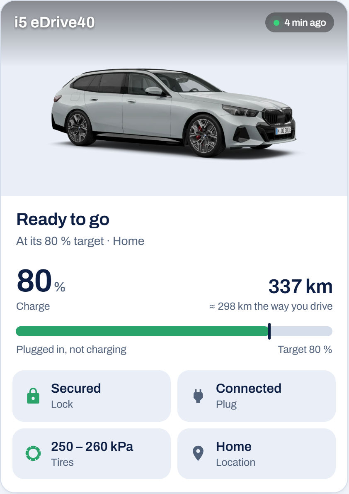
  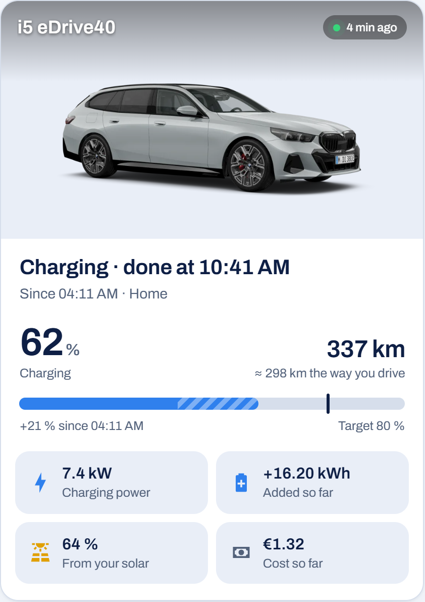
</p>

<p align="center">
  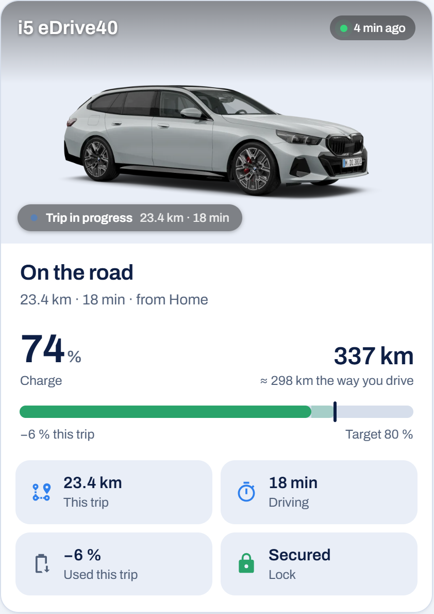
  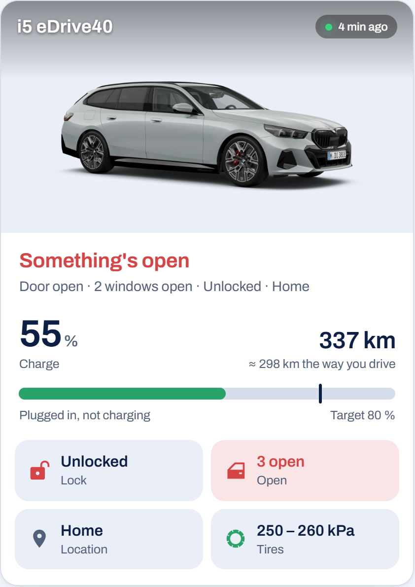
</p>

What the bar and tiles show follows the car's **drivetrain**, which the card
works out from what the car streams:

| Drivetrain | Bar | Beside it |
| --- | --- | --- |
| Electric | State of charge, with the target | Range, and the real range under it |
| Plug-in hybrid | State of charge, with the target, and the tank as a thin second line with the total range | Electric range |
| Petrol / diesel | Tank level, or the liters in the tank as a number on a car that doesn't stream a percentage | Remaining range |
| Neither, proved | No bar: the range is the big number | Odometer |

A petrol or diesel car shows nothing about charging: no target, no plug, no
charging tiles.

<p align="center">
  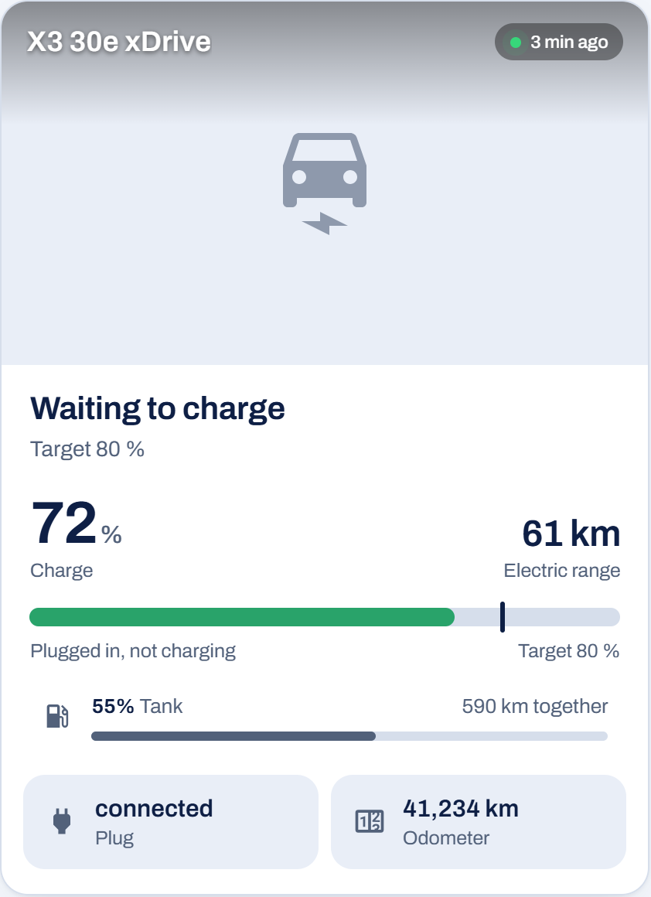
  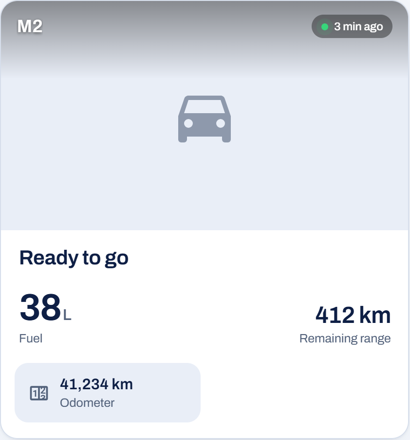
  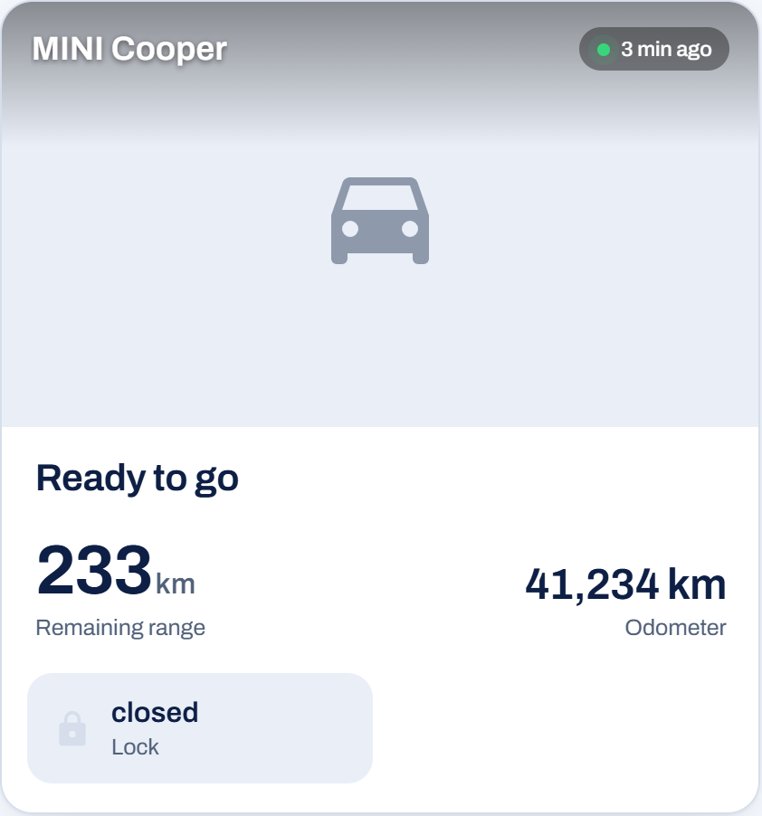
</p>

With **Configure → [Vehicle image](Settings-Reference#vehicle-image)** set to
BMW's configurator, the picture is your exact car, and dragging across it (mouse
or finger) turns it all the way round. The picture also follows the car:

- **Lights and time of day.** After sunset at home the car is shown at night,
  in a dark room with a pool of light under it, and while the car reports its
  lights on (*Vehicle Lights state*), with its lights on. The car itself is
  always BMW's own render: a BMW as BMW draws it at night, a MINI lit as in
  MINI's own configurator night scene.
- **Where it is open.** While something is open, the
  [top-down drawing](#security--closures-cluster-closures) appears in the corner
  with the open part lit up.
- **Interior.** The seat button switches to a 360° panorama of the interior,
  in the upholstery picked under
  [Configure → Vehicle image → Upholstery](Settings-Reference#vehicle-image) (BMW's default
  otherwise); drag to look around.

<p align="center">
  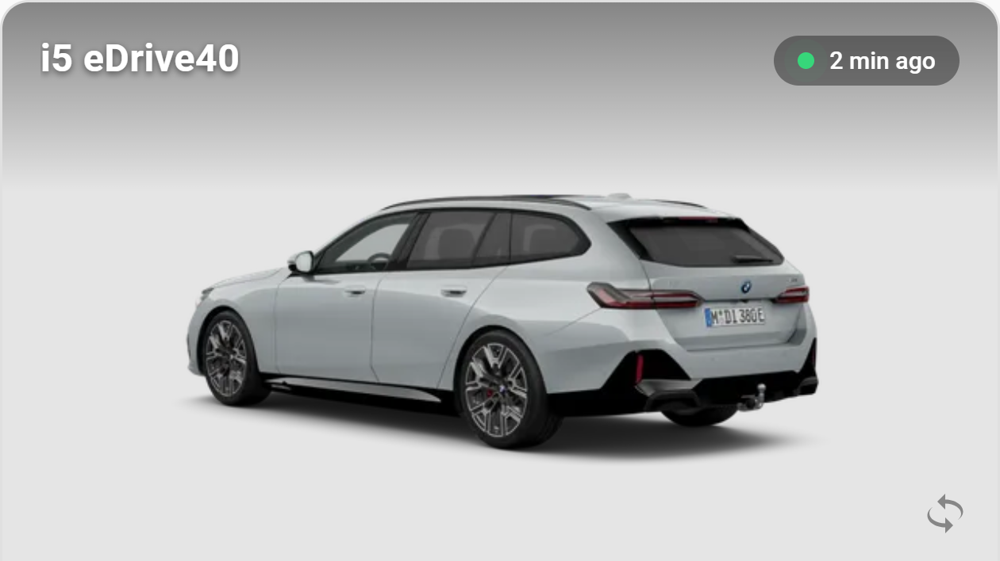
  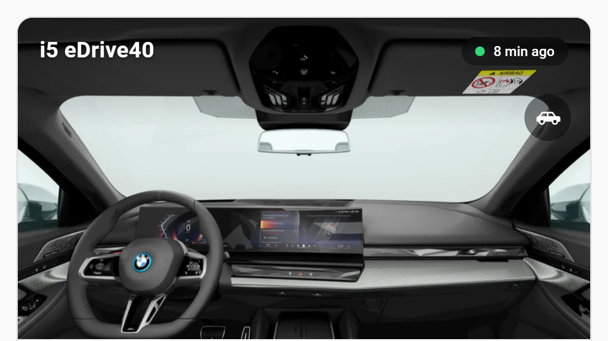
</p>

The card remembers the angle you turned the car to, whether you were inside or
out, and where you were looking inside, so a reload shows the car as you left
it. That is kept in your browser, so each device has its own.

The charge in the bar is the integration's own estimate. While the car
is parked that is simply BMW's last reading; while it charges it keeps climbing at
the rate the charging power implies, because BMW can go silent for hours
mid-charge and its own figure then stands still. With a wallbox meter bound,
[the meter drives it at home](Feature-evcc-and-Wallbox-Bridge#it-also-drives-the-state-of-charge-estimate).
The next real reading replaces it. See
[the charging page](Feature-Charging-History-and-Cost).

**Done at** in the top line, and the **Time to full** tile, are
[the integration's own figure](Feature-evcc-and-Wallbox-Bridge#time-to-the-charge-target)
while the car charges at home with a wallbox meter bound, and BMW's anywhere
else. They show the clock time the charge will be done, as *05:40* (with the
weekday when that isn't today); tap for the minutes left. If that figure has
stopped updating and its time has already passed, the tile shows the minutes
instead. Outside a charge the tile is labelled *Charge time*, and it is hidden
when that time is 0.

BMW's basic data decides the drivetrain first: it names the car as electric, plug-in
hybrid or combustion. Without it, a car that sends high-voltage battery data *and*
fuel data is a plug-in hybrid; fuel data alone makes it petrol or diesel. Some
petrol cars stream an EV charge target anyway, so that never makes a car look
electric. A petrol car that streams no tank at all shows its range instead.

A car that has only just been set up has proved nothing yet, and keeps the
electric layout until it does. But a car that has been talking for a while and
sent **neither** kind of data has proved something: it is not electric, whatever
else it is. Some do (a petrol MINI can stream no fuel system and no engine at
all), and showing it a charge it could never fill was simply wrong, so it
gets the last row above instead: its range as the big number, its odometer beside it,
and nothing about charging. If your car lands there and you know better, set
`drivetrain:` in the card's YAML.

```yaml
type: custom:bavariandata-card
```

If it picks the wrong layout, set **Drivetrain** in the visual editor, or:

```yaml
type: custom:bavariandata-card
drivetrain: ice   # bev · phev · ice — omit to auto-detect
```

The charging and efficiency views are built on charging data, so on a petrol or
diesel car they show the [Fuel view](#fuel-view-fuel) instead. Battery health says
*Nothing to show for this car* rather than sitting empty as if something were
broken. If that car does plug in, set **Drivetrain**.

While a drive is under way, a **Trip in progress** badge also appears at the bottom of
the picture with the distance and minutes so far; tap it for the full
attributes. It follows the *Trip in Progress* entity, so it lingers for a few
minutes after you arrive ([why](Feature-Trips#seeing-the-drive-thats-happening-now)).

Pin a specific vehicle with `device:` (device id) or `vin:`.

### Choosing the tiles

The tiles can show what you want instead. In the card editor, pick
**Tiles**: ready-made tiles first, then every entity of the car. Drag them into
the order you want. Leave it empty for tiles that change with what the car is
doing.

<p align="center">
  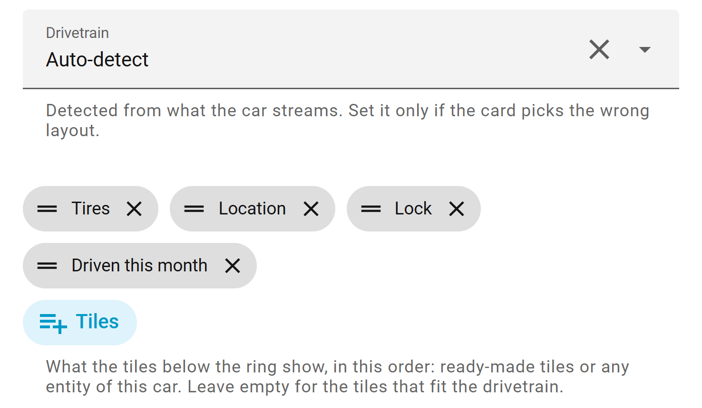
  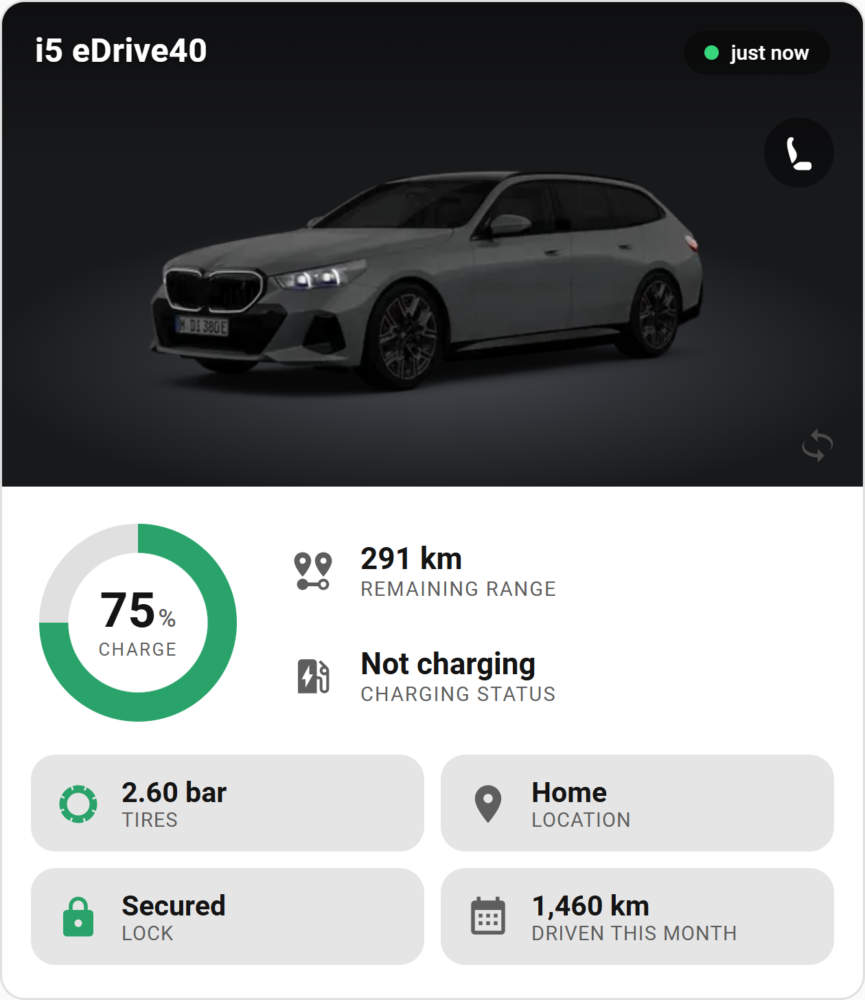
</p>

| Tile | Shows |
| --- | --- |
| `odometer` | The odometer |
| `tank` | The tank level, or the volume in the tank |
| `total_range` | Range on fuel and battery together (plug-in hybrids) |
| `target` | The charge target |
| `plug` | Whether the cable is in |
| `time_to_full` | When the charge will be done (the clock time) |
| `tires` | The lowest and highest tire pressure, green, amber or red as in the [Tires view](#tires-cluster-tire) |
| `location` | The zone the car is in, from its device tracker |
| `lock` | Locked, unlocked or secured |
| `distance_month` | The distance driven this month |
| `battery_12v` | The 12 V battery |

Any entity works too: it shows with its own name, without the car's, and its own
icon. In YAML a tile can also carry its own name and icon:

```yaml
type: custom:bavariandata-card
tiles:
  - tires
  - location
  - lock
  - sensor.x5_xdrive30d_coolant_temperature
  - entity: sensor.x5_xdrive30d_outside_temperature
    name: Outside
    icon: mdi:thermometer
```

The top line, the bar and the range beside it stay as the car sets them. A
petrol or diesel car that shows charging tiles has had its drivetrain detected
wrong: set **Drivetrain** (above) rather than replacing the tiles.


---

## Charging history (`view: charging`)

Each month opens with its figures: what was charged, what it cost (with the
price per kWh at home, *at least …* when a charge wasn't priced in full) and how many charges,
how many of them away. Under them, a bar of where the energy came from (sun,
house battery, grid, away) and the kWh of each day. Then the month's sessions,
newest first: the date, the charge from → to as a small bar, a Home/Away badge,
the energy and, under it, the cost. Tap a session to expand its **power curve**
(with its average as a dashed line), peak and average power, duration, and grid
energy. **CSV** and **Report** buttons export the month you are viewing
([see Export](Feature-Export)).

A charge in progress sits on top while it runs, with what it has added and cost
so far.

**One month at a time.** As on the trips view, a `‹ August 2026 ›` control under
the header scopes the figures and the list to one calendar month; page back for
older sessions.

```yaml
type: custom:bavariandata-card
view: charging
```

<p align="center">
  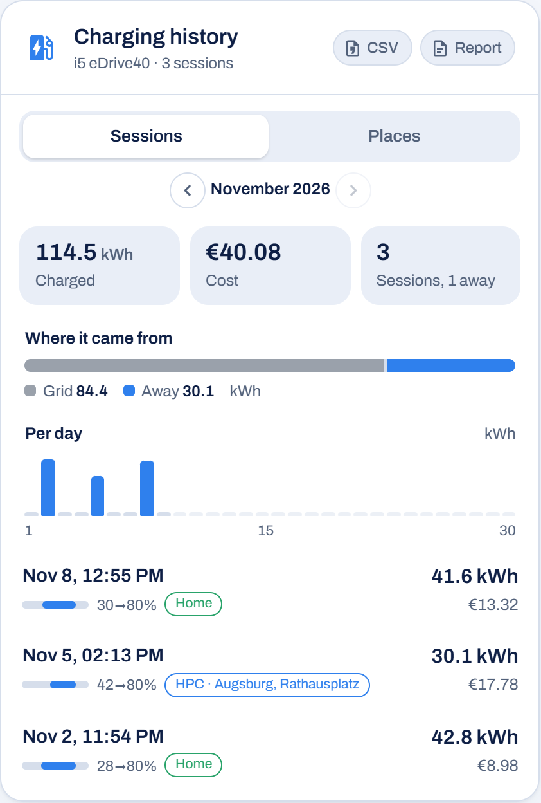
</p>

It reads the integration's stored history via the `get_charging_sessions`
service, so it spends **no API quota**. Cost only appears once a price source is
set under **Configure → Charging costs & history**
([see Charging history & cost](Feature-Charging-History-and-Cost)); until then
sessions still list with their energy. A session charged without GPS is badged
*Home · assumed*, and one priced while the tariff was briefly unknown is tagged
*partial price*.

**Places.** A **Sessions | Places** switch at the top shows, instead of the
month's sessions, every place the car has charged at: visits, AC or DC, the
average power and the typical stop. Tap a place for its best visit, minutes per
10 %, preconditioned vs. not, and the power curves of its latest visits on top of
each other. With **Remember charging locations** on, a map shows where the places
are. Places span the whole history, so the month control isn't shown there
([see Charging places](Feature-Charging-History-and-Cost#charging-places)).

With **Configure → Solar & energy sources** set up, a session that could be
attributed also carries a **☀ 62 % solar** tag, and expanding it adds an
*Energy source* line with the kWh per source
([see Where the energy came from](Feature-Charging-History-and-Cost)). Sessions
recorded before those sensors were configured simply have no tag — the card
never shows a 0 % that would really mean "not measured". A charge with no solar
in it (a night charge) has no tag either; its breakdown still says where the
energy came from.

---

## Battery health (`view: health`)

Shows the learned usable battery capacity as a gauge (percentage of the as-new
pack) with a capacity-vs-mileage trend below.

```yaml
type: custom:bavariandata-card
view: health
```

<p align="center">
  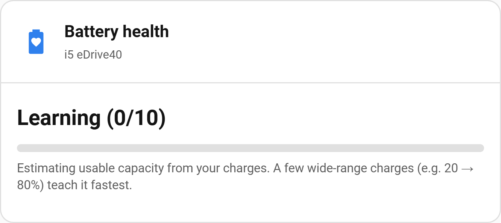
</p>

It reads the **Battery Health** sensor, so it spends **no API quota**. Until
there are enough wide-range charges to be sure of the number, it shows
*Learning (n/10)* rather than a figure that would jump around
([how it's learned](Feature-Battery-Health)).

---

## Efficiency & range (`view: efficiency`)

How far the car really goes from its current charge, set against what the car
itself says and, once trips have their weather, against mild weather; below it
the consumption that figure is built on.

```yaml
type: custom:bavariandata-card
view: efficiency
```

<p align="center">
  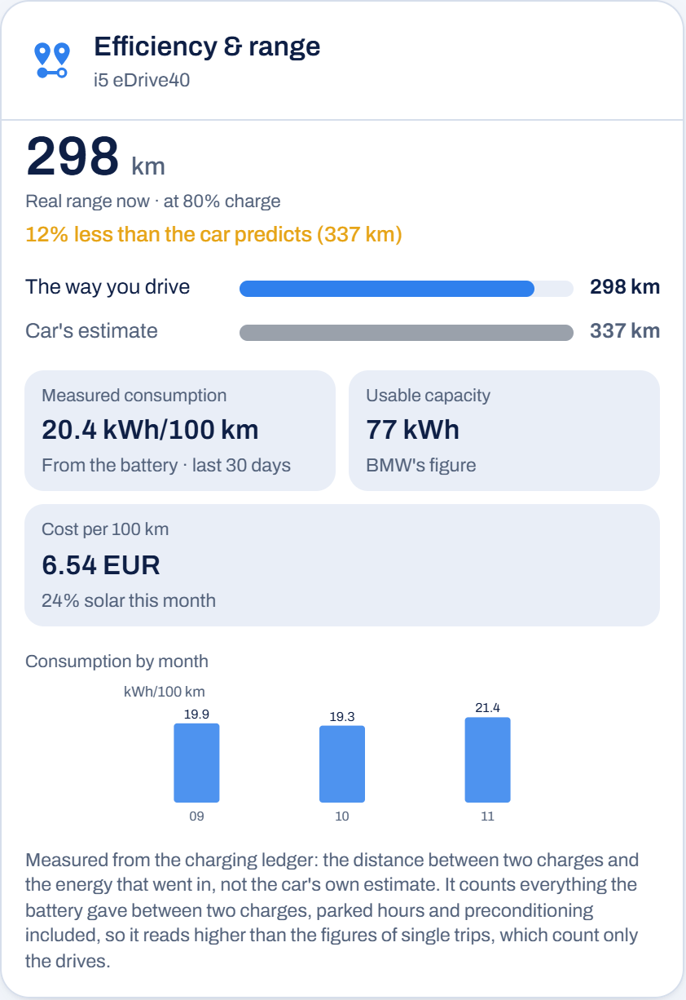
</p>

It shows the real range from here (and on a full battery), with bars setting it
against the car's own remaining-range prediction and, with trip weather on, what
the same charge would go at 15–25 °C, the measured consumption with the
side of the charger and the window it came from, the measured charging loss where
a grid figure exists, the usable capacity it divided into, your cost per 100 km
with the month's solar share, and a bar chart of consumption by calendar month —
the seasonal story, since winter consumption is routinely a third above summer.
With [Weather along the route](Feature-Trips#weather-along-the-route-opt-in) on, a
second chart shows consumption per 5 °C band of outside temperature and how much
more the car uses below 5 °C than at 15–25 °C, with today's band marked where
the car is parked
([how](Feature-Efficiency-and-Range#consumption-by-outside-temperature)); each
trip's detail in the trips view then shows its outside temperature too.
On a plug-in hybrid there is no consumption or range from the charging history
([why](Feature-Efficiency-and-Range#plug-in-hybrids)); it shows BMW's own lifetime
figures instead — electric consumption with the engine off, the share driven
electrically, fuel per 100 km — where the car sends them, and otherwise explains
why it is empty.

Everything is measured from the charging ledger — two charges bracket a distance
and the energy that went into it — so it spends **no API quota** and never
borrows the car's own estimate ([how it's measured](Feature-Efficiency-and-Range)).
That is also why it reads higher than the trips view's figure: it counts
everything the battery gave between two charges, parked hours and
preconditioning included, where a trip counts only the drive. Both stay, each
labelled.

Until there is enough charging history to bracket ~50 km of driving, the card
says so rather than showing a number.

---

## Mileage (`view: mileage`)

How far the car is driven, and how it stands against a lease or insurance
mileage limit when it has one.

```yaml
type: custom:bavariandata-card
view: mileage
```

<p align="center">
  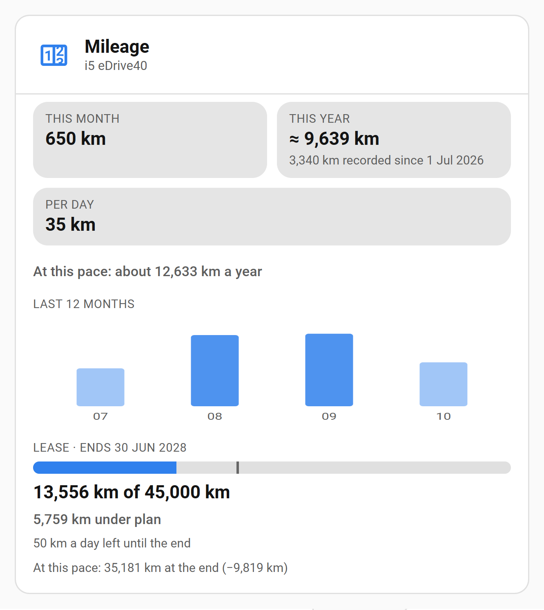
</p>

It shows this month, this year and the average per day, the yearly pace that
implies, and a bar per month for the last twelve. If recording began this year,
*this year* is estimated at your pace, with the recorded distance below it. The
pace waits for four weeks of readings. With a [mileage allowance](Feature-Mileage#a-mileage-allowance)
set up, a bar shows what's used of the allowance with a tick where the plan
stands today, followed by under or over plan, the distance a day left until the
end, and where the current pace lands. Without one, a line says where to add it.

Everything comes from the car's daily odometer readings, so it spends **no API
quota** and works for every drivetrain. Distances follow the car's odometer unit
(km or mi).

---

## Fuel (`view: fuel`)

A petrol, diesel or plug-in hybrid car's refuels and what it burns between them.
On a petrol or diesel car the charging and efficiency views show this too.

```yaml
type: custom:bavariandata-card
view: fuel
```

It shows the tank now (liters or percent, with the range), the average
consumption over the last 12 months, the distance and fuel since the last refuel,
and BMW's own lifetime figure where the car sends its OBFCM counters. Below them,
every refuel: when, the odometer, how much went in, and the consumption over the
stretch it closed.

<p align="center">
  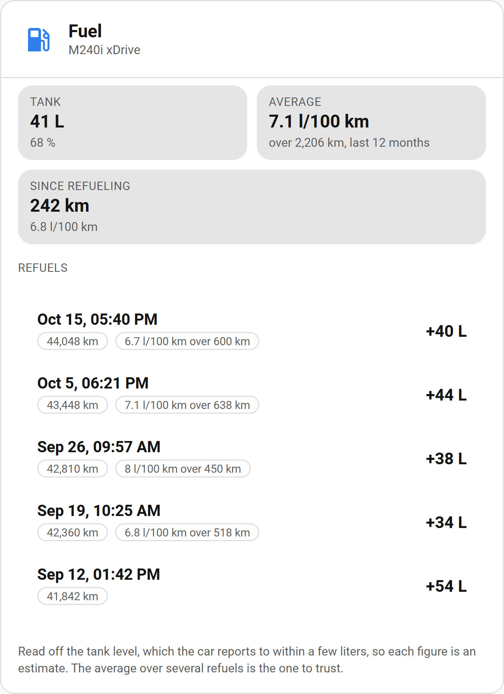
</p>

There is no pump receipt to read, so a refuel is recognised by the tank itself:
a rise of at least 5 L (8 % on a car that only streams a percentage) while the
car stands still. Between two refuels, what the tank lost over the odometer's
kilometers is the consumption, shown for stretches of at least 150 km. The car
reports its tank to within a few liters, so one stretch can be off by a liter or
so per 100 km; the average over several is the figure to trust. A car that sends
only a percentage gets its refuels listed but no l/100 km, because a percentage
can't be turned into liters without the tank size.

The log starts the day you update, so the first figure needs two refuels. It
spends **no API quota** ([service](Services-Reference#get_fuel_history)).
Consumption is always in l/100 km, distances follow the car's odometer unit.

---

## Trips / driving journal (`view: trips`)

Lists your recorded drives month by month, each day under its own heading with
the day's distance. A trip shows *from → to*, its type as a colored dot
(business, private, commute), the time, the duration and the weather on the way,
and its distance with its consumption beside it: green when it took less than
the month's average, amber when more. Tap one for consumption, recuperation and
the SoC used, to reclassify it, and (for drives recorded with **Record route**
on) a small map of the route, drawn as a clean line with a start and end marker;
nothing leaves your browser to draw it.

Above the list a **month in review** sums the distance (with a vs-last-month
delta), the business/private/commute split, the average on trips, energy
recuperated, a driving-style score and your top destinations, and, once a tariff
is set, an estimated driving cost. Tap a type in the split to list only those
trips; tap it again for all.

A **List | Map** switch at the top opens the [trip map](#trip-map-view-map) in
the same card.

**One month at a time.** A `‹ August 2026 ›` control under the header scopes the
list, the month-in-review and the **CSV** / **Report** buttons to a single
calendar month. Page back to reach older records — history is kept for two years
by default ([retention](Settings-Reference#charging-costs--history)), which is far more than any
one screen should show at once. Forward stops at the current month.

> **Average consumption** is measured from the charging ledger and the odometer,
> not from the trips, and is labeled **at the battery** or **at the plug**
> according to where the energy was actually measured — plug-side only once every
> charge carries a measured grid figure, in which case the battery-side figure
> appears beneath it with the charging loss between them. See
> [how consumption is measured](Feature-Trips#how-consumption-is-measured).

A drive still under way **leads the list**, marked with a live badge and an accent
edge: where you set off from, the distance and time so far, and — with **Record
route** on — the route as it grows. It carries no classification buttons, because
there is no stored trip to classify until it ends
([details](Feature-Trips#seeing-the-drive-thats-happening-now)).

```yaml
type: custom:bavariandata-card
view: trips
```

<p align="center">
  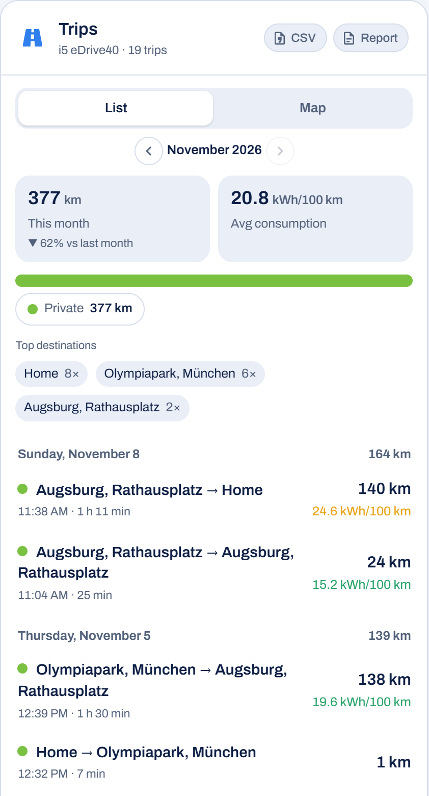
  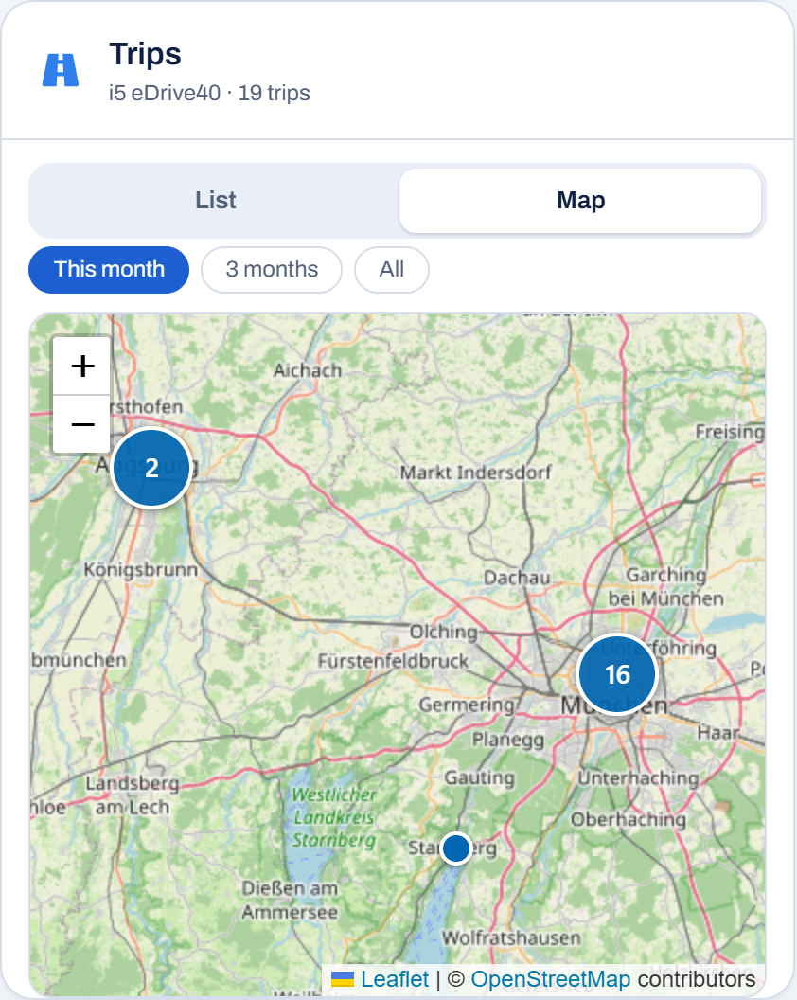
</p>

It reads the `get_trips` and `get_driving_summary` services, so it spends **no
API quota**. Trips are reconstructed from the stream — no configuration needed.
Endpoints are stored as **place names**, never coordinates. Set a **work zone**
under **Configure → Trips** so home↔work drives are recognized as commutes
([see Trips](Feature-Trips)).

> This is a trip journal and expense helper — **not a tax-office-compliant
> logbook** (*kein Finanzamt-konformes Fahrtenbuch*): it has no legal
> tamper-resistance.

---

## Trip map (`view: map`)

A **destinations map**: it plots where your trips **end**, and those markers
**cluster into counted bubbles when you zoom out and split apart as you zoom in** —
a quick read on where you go most. Only the end of each trip is shown (a trip's
start is the previous trip's end, so plotting both would double-count), giving an
honest "times arrived here" count. Click a cluster to zoom into it. A chip row
switches the time window — **This month** (default), **3 months** or **All**.

The [Trips](#trips--driving-journal-view-trips) view shows the same map on its
**Map** tab; `view: map` is the map alone. To see the *route* of a particular
drive, open the Trips view's list and expand that trip — its route is drawn on a
small map there.

```yaml
type: custom:bavariandata-card
view: map
```

<p align="center">
  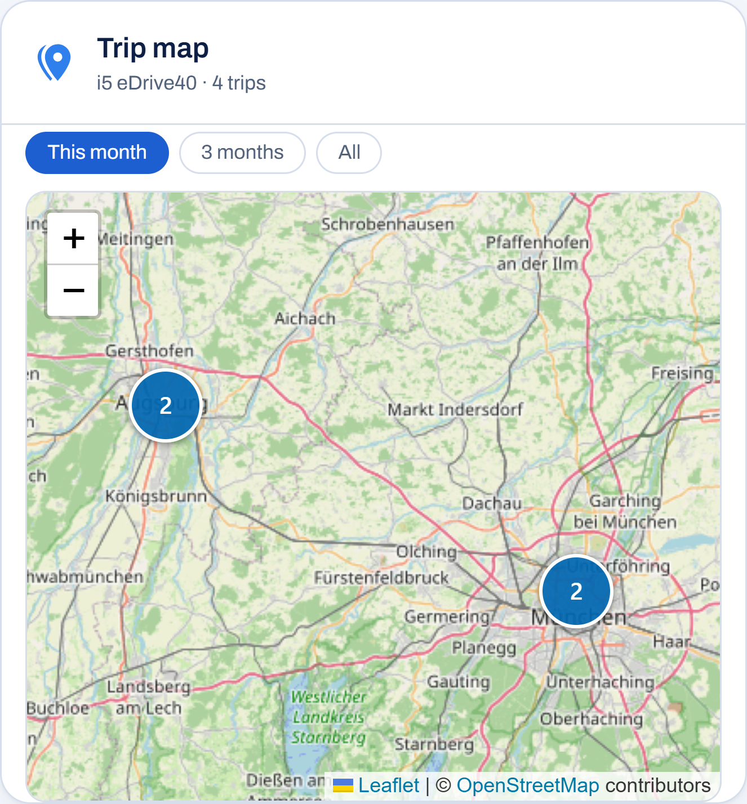
</p>

The map only has something to show once you turn on **Record route** under
**Configure → Trips** — that opt-in setting is what stores each drive's GPS
coordinates (it is the only place the integration keeps raw coordinates on disk,
and it is **off by default**). With it off, or before your first drive with it on,
the view explains that no places have been recorded yet. Drives recorded *before*
you enabled it have no coordinates to place.

It reads endpoints through the `get_trips` service, so it spends **no API quota**,
and it reuses Home Assistant's own map component and marker clustering (map tiles
load from OpenStreetMap, as they do for the built-in Map card).

> **Privacy:** unlike the rest of the history layer — which stores place *names*,
> never coordinates — this view uses the recorded coordinates of your trip
> endpoints, home included. Only enable route recording if you're comfortable with
> that, and remember the map is visible to anyone who can see the dashboard.

---

## The car (`view: car`)

Everything about the car itself in one card. On top, a banner says the most
pressing thing (something open, a tire to check, a Check Control message) or
*All good*, with what that covers. Under it, the car's own
[top-down drawing](#the-cars-shape) with whatever is open lit up and each tire
colored by its state, and the four pressures at its corners: tap one for that
tire's size, tread, season, when it was fitted and how long it has left.

Below, one line each, where the car has the data: the doors and lock, Check
Control (with earlier messages folded), the service items with their due date or
distance, the 12 V battery, [battery health](#battery-health-view-health), and
your [lease or yearly mileage limit](Feature-Mileage#a-mileage-allowance). Tap a
line for its entity.

```yaml
type: custom:bavariandata-card
view: car
```

<p align="center">
  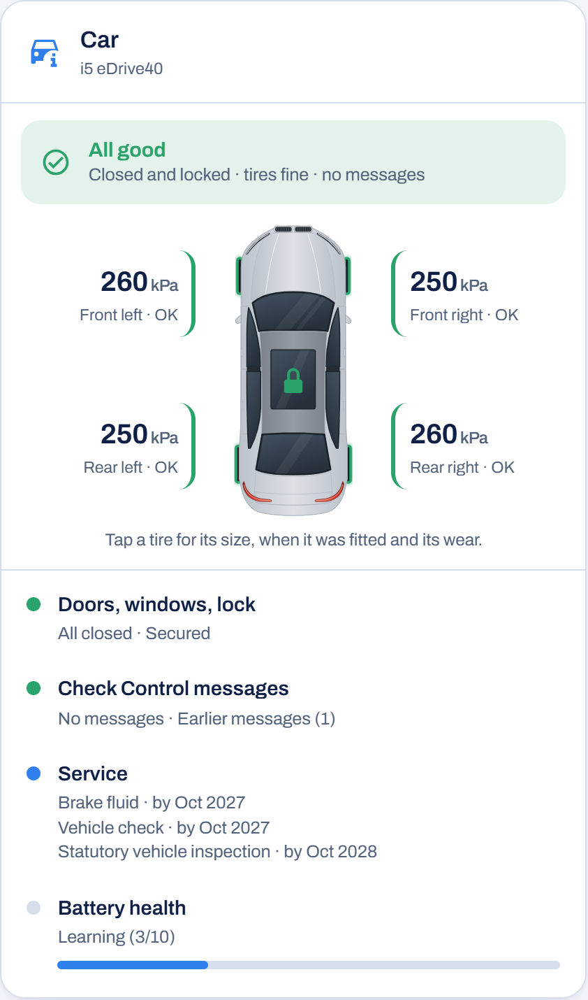
</p>

The [tires](#tires-cluster-tire), [closures](#security--closures-cluster-closures),
[health](#battery-health-view-health) and [mileage](#mileage-view-mileage) cards
stay as they are, for a dashboard that wants one of them alone. It reads only the
car's sensors and the mileage report, so it spends **no API quota**.

---

## Tires (`cluster: tire`)

Draws a top-down car with each tire colored by condition, a summary of the whole
set at the top, and each wheel's own readings and fitment beside it.

<p align="center">
  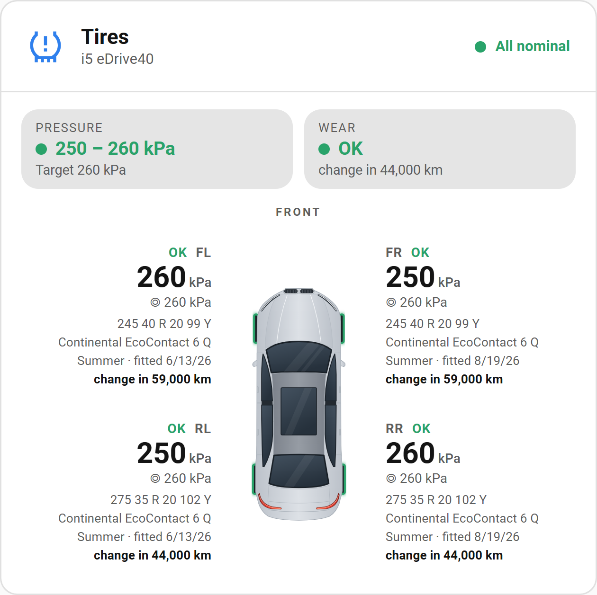
</p>

```yaml
type: custom:bavariandata-card
cluster: tire
```

**The summary** at the top holds the two things that can be wrong with a tire,
side by side: **Pressure** (the measured spread across the set, with the shared
target underneath) and **Wear** (BMW's verdict, with the mileage until the
soonest wheel is due). The badge in the header is the combined verdict for the
whole car.

**Pressure** comes from the stream, judged against each wheel's own target. The
band is deliberately lopsided — low from 8% under target, high only past 15%
over — because the target is a *cold* pressure and a tire you have just driven on
reads 8–10% high without anything being wrong.

**Wear** comes from BMW's smart-maintenance tire diagnosis, refreshed by the
[daily refresh](Feature-API-Quota#the-daily-refresh). When it is available, each
wheel also shows its own size, tread pattern, season, fitting date and the
mileage until a change is due. These are per wheel on purpose: staggered setups
(different sizes front and rear) are normal, and a single line under the diagram
would have to pick one to show.

Wear outranks pressure in the color and the header: a tire BMW flags as worn
reads *"Check tires"* even at perfect pressure, because pressure is trivially
fixable and tread is not. If your car has no tire service record on file BMW
returns nothing here, the wear parts are simply absent, and the card shows
pressure alone.

On a narrow dashboard column the car diagram drops out and the four wheels fall
back to a 2×2 grid, front row over rear.

---

## Security & closures (`cluster: closures`)

Shows doors, windows, hood, trunk, sunroof, the central lock and the anti-theft
alarm on the same car diagram. Open doors highlight red, open windows/sunroof
amber, and a central padlock reflects the lock state — read from the streamed
**Doors overall state**, so it tracks the real lock rather than the stale
REST-only *Doors lock*
([why](Feature-Entities-and-Devices#which-lock-entity-to-use)); a badge summarises the
worst-case status and every part taps through to the underlying entity. Parts
the vehicle doesn't report are simply omitted.

<p align="center">
  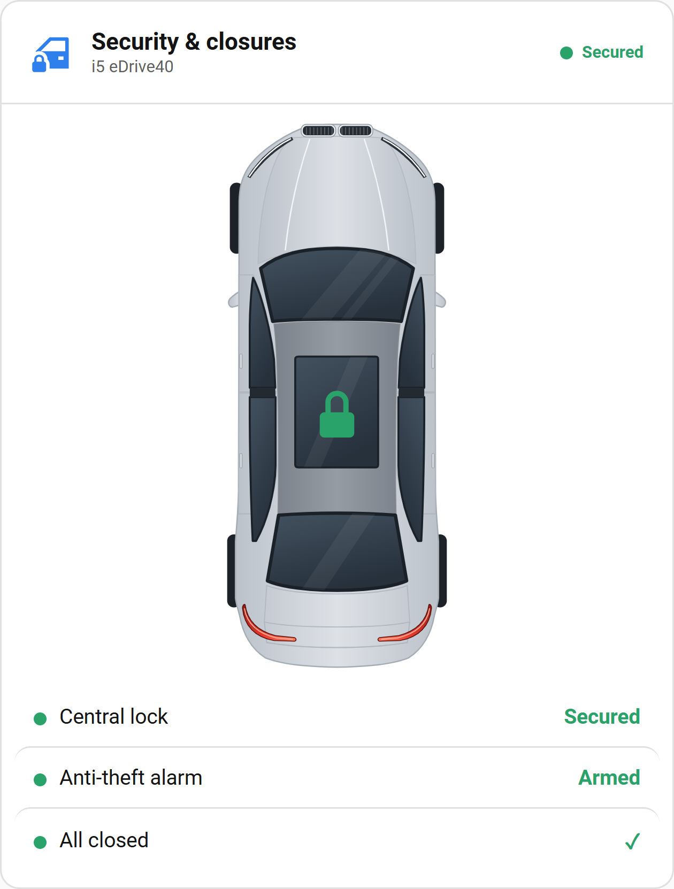
</p>

```yaml
type: custom:bavariandata-card
cluster: closures
```

BMW reports the side doors and windows by seat (the driver's door, the
passenger's), not by side. The card therefore places them by the car's
steering side, which it reads from BMW's basic data, so on a right-hand-drive
car the driver's door is drawn on the right. If they show up on the wrong side,
set **Steering wheel** in the visual editor, or:

```yaml
type: custom:bavariandata-card
cluster: closures
steering: right   # left · right — omit to read it from BMW's vehicle data
```

<p align="center">
  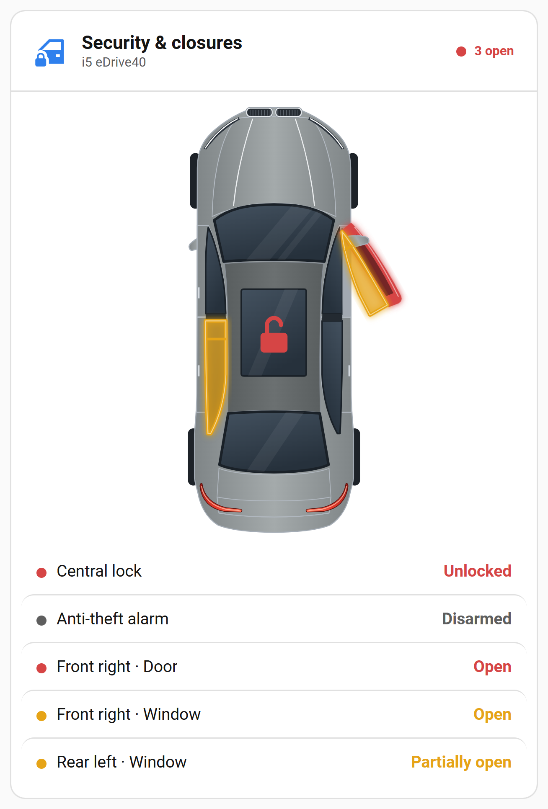
</p>

### The car's shape

The tires and closures views draw a BMW sedan, except for a **MINI Countryman**,
which gets its own drawing: boxier, with a clamshell hood, roof rails and the
two-panel glass roof. The card picks it from the model name in BMW's basic data,
so there is nothing to set. To force one shape or the other, set **Car shape** in
the visual editor, or:

```yaml
type: custom:bavariandata-card
cluster: closures
shape: countryman   # sedan · countryman — omit to pick it from BMW's vehicle data
```

<p align="center">
  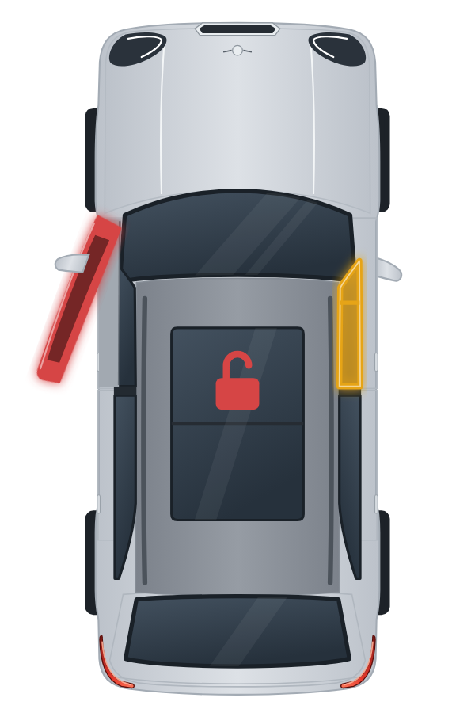
</p>

Other models, including the other MINIs, use the sedan for now.

With **Configure → [Vehicle image](Settings-Reference#vehicle-image)** set to
BMW's configurator, the drawing takes your car's real paint color, sampled from
the configurator's picture. For a MINI, BMW also has a real photo from above,
which the tires view then shows instead of the drawing (the tire readings stay
in their corners). BMW has no such view for any BMW model.

---

## Equipment (`view: equipment`)

The car's factory equipment, named: paint, wheels and trim first, then the
packages, then every other option the car was built with, each with BMW's code.
What BMW treats as technical (refrigerant, the language of the paperwork,
emission controls) is folded away under **Technical codes**. Options BMW has a
picture for show it in front of the name: a swatch for the paint, wheels and
roof, a small photo for the rest. Most technical codes have none. To keep a
plain list, turn off **Show option pictures** in the card editor
(`pictures: false`).

```yaml
type: custom:bavariandata-card
view: equipment
```

<p align="center">
  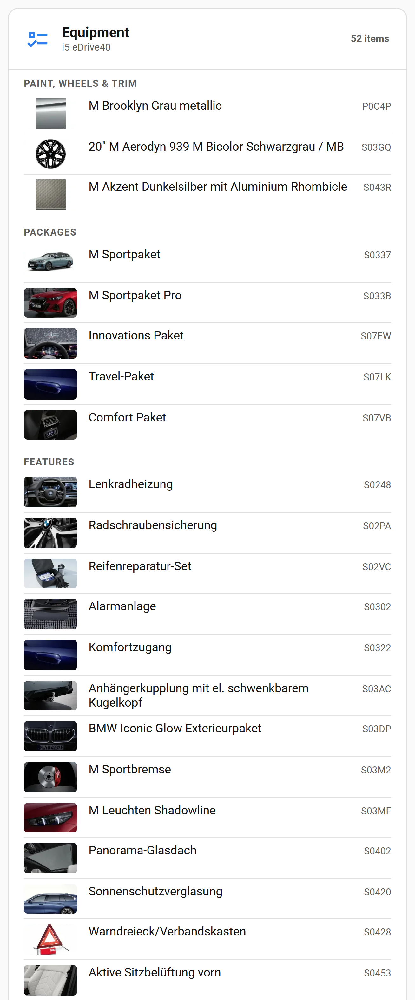
</p>

It needs **Configure → [Vehicle image](Settings-Reference#vehicle-image)** set to
BMW's configurator, which names the codes in BMW's basic vehicle info; until
then the card says so. The names are BMW's, in the language BMW's market for
your car offers: English where it has it, otherwise the market's own (a car
sold in Germany may list in German). If BMW's data for your market is missing
your model, another market in the same language fills in.

---

## Single-cluster list

Set `cluster:` to list every value in one catalogue cluster. Use one card per
cluster:

```yaml
type: custom:bavariandata-card
cluster: electric   # electric · status · tire · usage · events · basic · contract · metadata · other
```

The card groups entities via their `cluster`/`category` **attributes**, not their
names — so it works regardless of the user's Home Assistant language.

`cluster: events` leads with the car's **Check Control messages** — the warnings
the car shows on its own display, such as low washer fluid — and says so when
there are none. Tap a message to expand it: the mileage at which the car last
showed it, how long ago the car sent it, and BMW's message code. The text is shown as BMW sends it, which is English whatever your
language. A message the car no longer reports — the washer fluid has been topped
up — leaves the list and moves under **Earlier messages**, folded away until you tap
it, with the day it was last reported and the day it stopped. The car sends its
messages when a drive starts and the integration reads them once a day, so a
cleared warning can take up to a day and a drive to move. The messages come from the *Check Control messages* sensor, which BMW
files under usage-based data; BMW's own *Vehicle events* cluster holds only two
teleservice timestamps, listed below the messages when the car sends them.

<p align="center">
  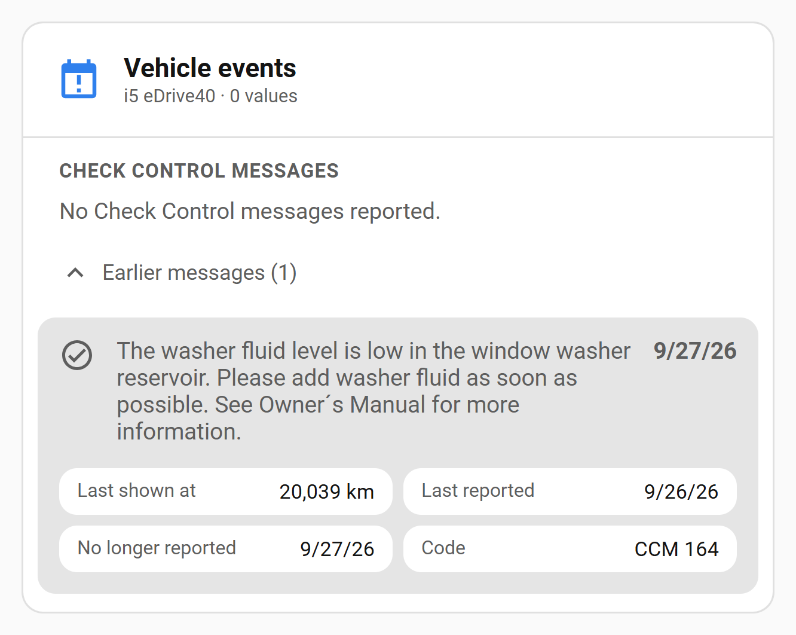
</p>

---

## The hub (`hub: true`)

The Overview can carry the other views as rooms under it. Turn on **Rooms
under the overview** in the visual editor, or:

```yaml
type: custom:bavariandata-card
hub: true
```

Under the tiles, one row per room says what that room would say first:
**Charging** (this month's kWh and cost), **Trips** (this month's distance and
number of trips), **Efficiency** (the real range and consumption) and **Car**
(all good, or what isn't: something open, a tire, a Check Control message;
otherwise the next service). A petrol or diesel car lists **Fuel** (the last
refuel and the average) instead of Charging and Efficiency, and a plug-in hybrid
lists it after Charging; a car that proved no drivetrain lists Trips and Car. While the car charges, the Charging row
says so with what this charge has added; on a drive, the Trips row does.

Tap a row and the room opens in the same card, drawn exactly as its own
`view:` card would be, with an arrow at its top back to the overview. The card
remembers nothing: a reload starts on the overview. Without `hub: true`, the
Overview is unchanged, and every `view:` card works on its own as before.

<p align="center">
  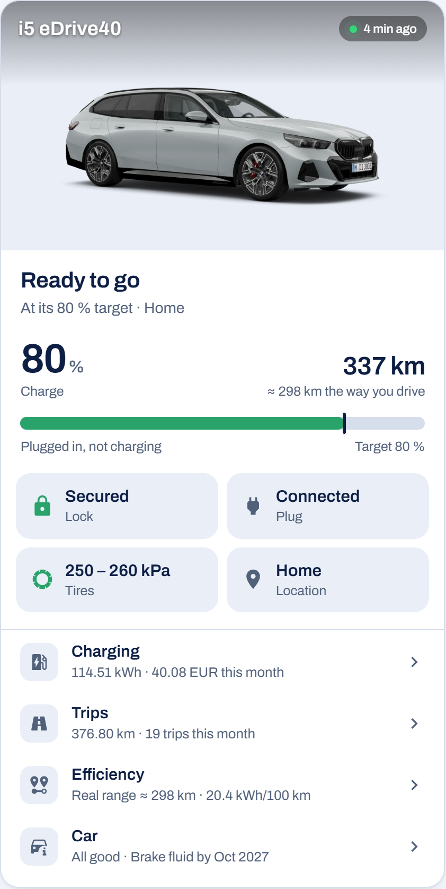
  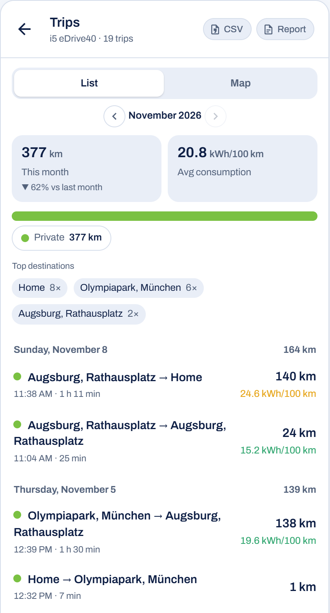
</p>

---

## Small cards and the garage (`view: glance`, `view: row`, `view: garage`)

Three compact cards for a dashboard's first screen. They read the car exactly
as the Overview does: the same charge (or tank), range and top line.

- **`view: glance`**: a tile half a section wide with the car's picture, its
  charge and range, a thin bar with the target, the top line (*Ready to go*,
  *Charging · done at 05:40*, …), and the lock and plug as small icons. While
  charging, the power sits beside the name.
- **`view: row`**: the same in one line: picture, top line, the car's name
  with the facts behind it, and the charge and range at the end.
- **`view: garage`**: every car of every account in one card, one row each
  with its picture, charge, bar, top line and range. It needs no `device:`.

A tap opens the car's charge (or tank). With **Open on tap**
(`navigation_path:`) it opens another dashboard instead, for example one
holding the hub:

```yaml
type: custom:bavariandata-card
view: glance
navigation_path: /car-hub/0
```

In a sections dashboard the glance tile starts half a section wide, so two
cars sit side by side; every other view fills the width.

<p align="center">
  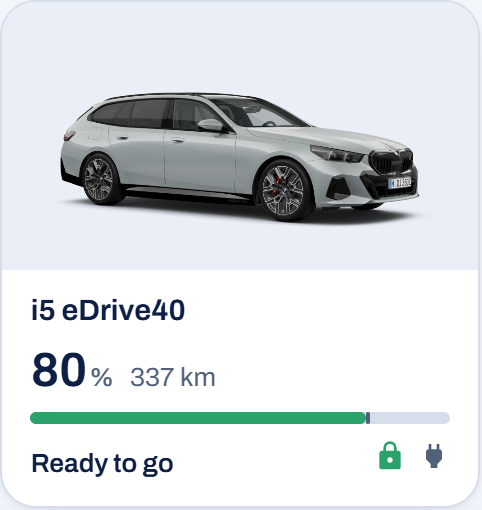
  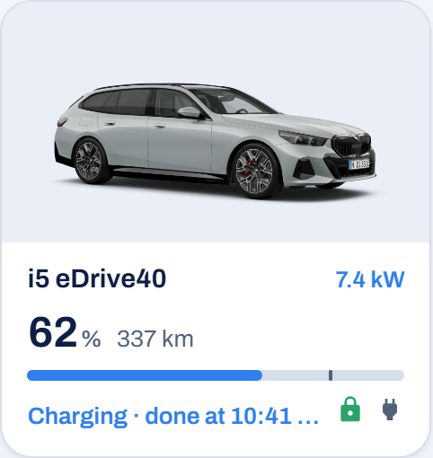
</p>

<p align="center">
  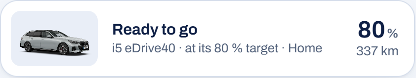
  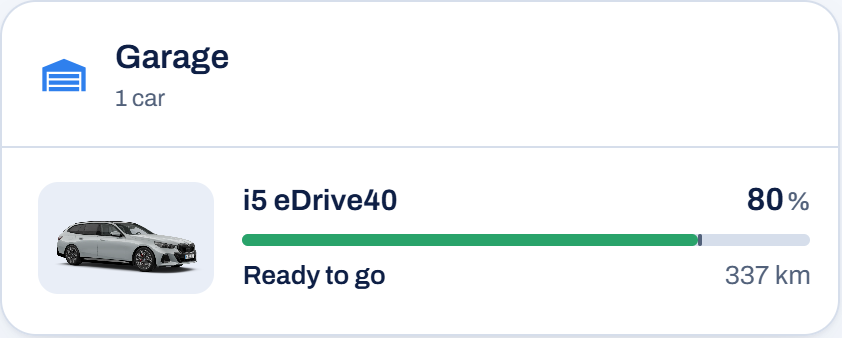
</p>

## Coming from an older card

Every card you already have keeps working, with the same YAML, in the new look.

| Your card | Now |
| --- | --- |
| `type: custom:bavariandata-card` | The overview: top line, bar, tiles that follow the car. No rooms unless you add `hub: true`. |
| `tiles: […]` | Your tiles, in every situation. |
| `drivetrain:`, `device:`, `vin:`, the entity overrides | Unchanged. |
| `view: charging` · `trips` · `efficiency` · `fuel` | The same view, redrawn. |
| `view: map` | Unchanged; the Trips view also opens it on its Map tab. |
| `view: health` · `mileage` · `equipment`, `cluster: …` | Unchanged; health and mileage are also a line each in `view: car`. |
| `custom:bmw-cardata-card` | Still works. |

New: `hub: true`, `view: car`, `view: glance`, `view: row`, `view: garage`.

---

## Full YAML reference

| Key | Purpose |
| --- | --- |
| `type` | Always `custom:bavariandata-card`. |
| `view` | `charging`, `trips`, `map`, `health`, `efficiency`, `mileage`, `fuel`, `equipment`, `car`, `glance`, `row` or `garage`. Omit for the Overview. |
| `cluster` | `electric`, `status`, `tire`, `usage`, `events`, `basic`, `contract`, `metadata`, `other`, `closures`. Renders a single-cluster list (or the special tire/closures diagrams). |
| `device` | Device id, to pin a specific vehicle. The visual editor lists your cars only, never the account's own diagnostics device (*BMW CarData*); a card set to it shows the first car instead. |
| `vin` | VIN, as an alternative to `device`. |
| `title` | Override the card title entity. |
| `image` | Override the vehicle-image entity. |
| `soc` | Override the state-of-charge entity. |
| `range` | Override the range entity. |
| `charging` | Override the charging-status entity. |
| `target_soc` | Override the target-SoC entity. |
| `time_to_full` | Override the time-to-full entity. |
| `odometer` | Override the odometer entity. |
| `plug` | Override the plug-status entity. |
| `drivetrain` | `bev`, `phev` or `ice` — the Overview layout. Omit to detect it from what the car streams. |
| `tiles` | The Overview's tiles, in order: ready-made tiles (`odometer`, `tank`, `total_range`, `target`, `plug`, `time_to_full`, `tires`, `location`, `lock`, `distance_month`, `battery_12v`), entity ids, or `{entity, name, icon}`. Omit for the drivetrain's own. See [Choosing the tiles](#choosing-the-tiles). |
| `steering` | `left` or `right` — the side the driver sits on, used to place doors and windows in the closures view. Omit to read it from BMW's basic data; a car whose basic data doesn't say is drawn as left-hand drive. |
| `shape` | `sedan` or `countryman` — the car drawn in the tires and closures views. Omit to pick it from the model in BMW's basic data. |
| `pictures` | `false` — the Equipment view as a plain list, without the option pictures (**Show option pictures** in the visual editor). Omit to show them. |
| `fuel` | Override the fuel-tank entity (a percentage or a volume). |
| `hub` | `true`: the Overview with the rooms under it (**Rooms under the overview**). See [The hub](#the-hub-hub-true). |
| `navigation_path` | A dashboard path the `glance`, `row` and `garage` cards open on a tap (**Open on tap**). Omit to open the car's charge or tank. |

With the integration installed, entity overrides are rarely needed — the card
auto-discovers them from the vehicle's device. Use them only if you've renamed
entities or want to point the card at a helper.

---

> **Does this look right on your car?** A screenshot of the card on your model
> is the single most useful thing you can send — especially if a view comes up empty, a value looks wrong, or a cluster you
> expected is missing.
> [Post it in Discussions →](https://github.com/JustChr/BavarianData/discussions)
