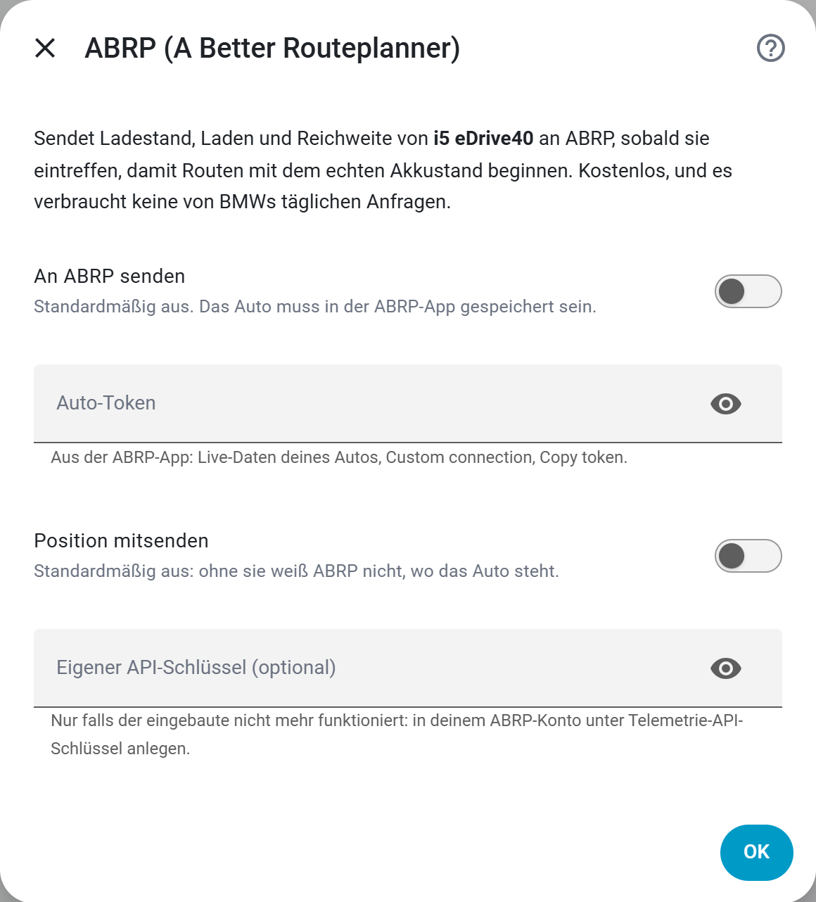

# ABRP-Live-Daten: der Akku deines BMW in A Better Routeplanner

> 🇬🇧 [English version](Feature-ABRP)

[ABRP (A Better Routeplanner)](https://abetterrouteplanner.com) plant eine Fahrt
samt Ladestopps. Dabei geht es von einem geschätzten Akkustand aus, solange
niemand ihm den echten sagt. BavarianData kann das übernehmen: Es sendet den
Live-Zustand deines BMW oder MINI aus BMW CarData an ABRP. So beginnt die Planung
mit dem tatsächlichen Ladestand, und ABRP plant unterwegs neu, während sich der
Akku leert.

- **Kostenlos.** Es funktioniert mit einem kostenlosen ABRP-Konto, ABRP Premium
  ist nicht nötig.
- **Kein API-Kontingent.** Es läuft über BMWs Live-Stream, nicht über die
  [50 Anfragen pro Tag](DE-Feature-API-Quota).
- **Standardmäßig aus, pro Auto.** Nichts verlässt Home Assistant, bevor du es
  für ein Auto einschaltest.

## Was ABRP bekommt

| ABRP zeigt | Woher |
| --- | --- |
| Ladestand (SoC) | Derselbe Wert wie auf der Karte, der [beim Laden weiterzählt](DE-Feature-State-of-Charge), auch wenn BMW schweigt |
| Laden, und ob an einem DC-Schnelllader | BMWs Ladestatus und Lademethode |
| Ladeleistung | BMWs Ladeleistung |
| Geparkt oder unterwegs | BMWs Bewegungssignal oder BavarianDatas [Fahrterkennung](DE-Feature-Trips) |
| Kilometerstand und Reichweite | BMWs Kilometerstand und elektrische Reichweite |
| Position und Höhe | Nur mit eingeschaltetem **Position mitsenden** |

Ein Wert, den das Auto nicht gemeldet hat, fehlt, statt als Null gesendet zu
werden. Ohne jeden Ladestand wird gar nichts gesendet. BMWs Stream kann bei einem
geparkten Auto stundenlang still sein, deshalb werden die letzten bekannten Werte
alle 30 Sekunden wiederholt. So hält ABRP das Auto nicht für offline.

## Einrichten

1. **In der ABRP-App:** Speichere dein Auto und öffne es, dann **Live data →
   Custom connection** und unter *Generic token* auf **Copy token** tippen. Hat
   das Auto schon eine Verbindung, öffnen sich stattdessen seine Live-Daten: dort
   zuerst auf **Edit** tippen.
2. **In Home Assistant:** **Einstellungen → Geräte & Dienste → BavarianData →
   Konfigurieren → Live-Daten teilen → ABRP (A Better Routeplanner)**. Mit mehr
   als einem Auto wählst du zuerst das Auto.
3. **An ABRP senden** einschalten, den Token in **Auto-Token** einfügen und
   **OK** drücken. Der Token wird sofort bei ABRP geprüft. Einen abgelehnten
   Token meldet der Bildschirm, nicht nur das Protokoll.

Binnen einer Minute zeigt die ABRP-App die Live-Daten des Autos mit der Quelle
**API**.

  

Jedes Feld beschreibt die
[Einstellungsreferenz](DE-Settings-Reference#abrp-a-better-routeplanner).

## Fragen

### ABRP verlangt Premium, bevor es einen Token herausgibt

Ein kostenloses ABRP-Konto hält **ein** gespeichertes Auto. Ist ein zweites
gespeichert, verlangt die App Premium, bevor sie einen Live-Daten-Token
herausgibt. Entferne das andere Auto oder nutze ein ABRP-Konto pro Auto.

### Sieht ABRP, wo das Auto steht?

Nur wenn du **Position mitsenden** einschaltest, standardmäßig ist es aus. Ohne
bekommt ABRP von BavarianData Akku, Laden und Kilometerstand, aber keinen
Standort.

### Zwei Autos

Jedes Auto hat seinen eigenen Token und eigene Schalter; ein später
hinzugefügtes Auto übernimmt sie nicht. Siehe
[mehrere Fahrzeuge](DE-Feature-Multiple-Cars-and-Accounts).

### In ABRP kommt nichts an

- Das Protokoll meldet *ABRP refused the car token or the API key*: Kopiere den
  Token erneut aus der App, wie in Schritt 1.
- Das Auto hat seit dem Start von Home Assistant noch keinen Ladestand gemeldet:
  Dann gibt es noch nichts zu senden. Die nächste Meldung startet es.
- Releases bringen BavarianDatas eigenen ABRP-API-Schlüssel mit. Falls ABRP ihn
  einmal nicht mehr annimmt, lege in deinem ABRP-Konto unter Telemetrie-API-Schlüssel
  einen eigenen an und trage ihn in **Eigener API-Schlüssel (optional)** ein.

### Ist das dasselbe wie ABRPs eigene BMW-Anbindung?

Nein. BavarianData sendet, was dein Home Assistant von BMW CarData bekommt, mit
deiner eigenen Client-ID. Kein anderer Server sitzt zwischen BMW und Home
Assistant, und ABRP bekommt nur die Werte aus der Tabelle oben.
