# Die Dashboard-Karte

> 🇬🇧 [English version](The-Dashboard-Card)

Eine eigene **BavarianData Card** liegt der Integration bei und wird automatisch als
Dashboard-*Ressource* eingetragen. Von Hand musst du keine Ressource anlegen; bei
jedem Update wird sie erneuert, damit der Browser die neue Version lädt.

**Die Integration legt kein eigenes Dashboard an.** Die Registrierung macht die
Karte *verfügbar*; wohin sie kommt, bestimmst du:

1. Öffne ein beliebiges Dashboard und klicke auf **✏️ Bearbeiten → ➕ Karte
   hinzufügen**.
2. Suche nach **BavarianData Card** und wähle sie aus — ein visueller Editor öffnet
   sich.
3. Speichere. Schon die kürzeste Konfiguration findet das Auto selbst, auszufüllen
   gibt es also nichts:

   ```yaml
   type: custom:bavariandata-card
   ```

> Die automatische Registrierung braucht Ressourcen im Speichermodus, das ist der
> Standard. Werden deine Dashboard-Ressourcen per YAML verwaltet, musst du die
> Ressource selbst hinzufügen — siehe
> [Fehlerbehebung](DE-Troubleshooting-and-FAQ#config-error-after-reload).

Die Karte hat mehrere **Ansichten**. Standard ist die Übersicht; mit `view:` oder
`cluster:` wählst du eine andere. Nutze **eine Karte pro Ansicht** und stelle
mehrere Karten nebeneinander, oder lass die Übersicht die anderen als Bereiche in
derselben Karte öffnen ([der Hub](#the-hub-hub-true)). Kleine Größen für den
ersten Bildschirm eines Dashboards stehen [weiter unten](#small-cards-and-the-garage-view-glance-view-row-view-garage).

> Erscheint die Karte nach einem Update nicht, **lade den Browser hart neu**.
> Funktioniert sie im Browser, aber die **Companion App** meldet *Custom element
> doesn't exist*, leere den Frontend-Cache der App — siehe
> [Fehlerbehebung](DE-Troubleshooting-and-FAQ#custom-element-doesnt-exist-app).

- [Übersicht](#overview)
- [Der Hub](#the-hub-hub-true)
- [Kleine Karten und die Garage](#small-cards-and-the-garage-view-glance-view-row-view-garage)
- [Ladeverlauf](#charging-history-view-charging)
- [Batteriezustand](#battery-health-view-health)
- [Effizienz & Reichweite](#efficiency--range-view-efficiency)
- [Fahrten / Fahrtenbuch](#trips--driving-journal-view-trips)
- [Fahrtenkarte](#trip-map-view-map)
- [Das Auto](#the-car-view-car)
- [Reifen](#tires-cluster-tire)
- [Sicherheit & Öffnungen](#security--closures-cluster-closures)
- [Ausstattung](#equipment-view-equipment)
- [Liste einer Datengruppe](#single-cluster-list)
- [Von einer älteren Karte](#coming-from-an-older-card)
- [Vollständige YAML-Referenz](#full-yaml-reference)

---

## Übersicht

<a id="overview"></a>

Das Bild des Autos, eine Zeile, die sagt, was das Auto gerade tut, sein
Ladestand (oder Tank) als Balken mit der Reichweite daneben und vier Kacheln,
die zum Moment passen.

**Die Zeile oben** beantwortet *Kann ich los?* in Worten, darunter die Fakten
dazu (wo, seit wann, welche Tür). Die erste, die zutrifft, gewinnt:

| Zeile oben | Wann | Darunter |
| --- | --- | --- |
| *Etwas ist offen* (rot) | Eine Tür, ein Fenster, Kofferraum, Motorhaube oder Schiebedach ist offen, oder das Auto ist geparkt, entriegelt und lädt nicht | Was offen ist, das Schloss, wo |
| *Lädt · fertig um 05:40* | Das Auto lädt | Seit wann, wo |
| *Unterwegs* | Eine Fahrt läuft | Strecke und Minuten bisher, wo sie begann |
| *Wartet aufs Laden* | Angesteckt unter dem Ziel, lädt nicht | Das Ziel, wo |
| *Bald laden* / *Bald tanken* (gelb) | Unter 20 % und nicht angesteckt | Wie weit es noch kommt, wo |
| *Startklar* | Sonst | *Bei seinem Ziel von 80 %*, wenn angesteckt, wo |

Eine offene Tür geht einer Ladung vor, damit eine über Nacht in der Einfahrt
offene Tür nie hinter *fertig um* verschwindet; bloß entriegelt nicht, denn viele
Autos laden entriegelt in der Garage. Tippe die Zeile an für die Entität
dahinter, etwa die Minuten bis zum Ende einer Ladung.

**Der Balken** ist der Ladestand, das Ziel als Strich. Beim Laden ist er blau,
und was diese Ladung hinzugefügt hat, ist gestreift (*+21 % seit 04:06*); auf
einer Fahrt zeigt er blass, was die Fahrt verbraucht hat (*−6 % diese Fahrt*).
Sonst ist er grün, ab 40 % gelb, ab 15 % rot und sagt, ob das Kabel steckt.
Neben der Zahl steht die Reichweite, darunter *≈ 298 km so, wie du fährst*,
sobald die [echte Reichweite](DE-Feature-Efficiency-and-Range) bekannt ist.

**Die Kacheln** folgen dem, was das Auto gerade tut, die ersten vier, für die
das Auto Daten hat:

| Lage | Kacheln |
| --- | --- |
| Geparkt | Schloss, Stecker, Reifen, Standort, Kilometerstand, diesen Monat gefahren |
| Lädt | Ladeleistung, bisher geladen, Anteil aus deiner Solaranlage, bisherige Kosten, Zeit bis voll, Stecker |
| Unterwegs | Strecke, Minuten und verbrauchter Ladestand dieser Fahrt, Schloss |
| Etwas offen | Schloss, was offen ist, Standort, Reifen |

Leistung, Solaranteil und Kosten erscheinen nur, während eine Ladung läuft und
die Integration sie kennt (Kosten nur zu Hause und mit Tarif; siehe
[den Sitzungssensor](DE-Feature-Charging-History-and-Cost)). Deine eigenen
[`tiles:`](#choosing-the-tiles) ersetzen das und bleiben in jeder Lage gleich.

<p align="center">
  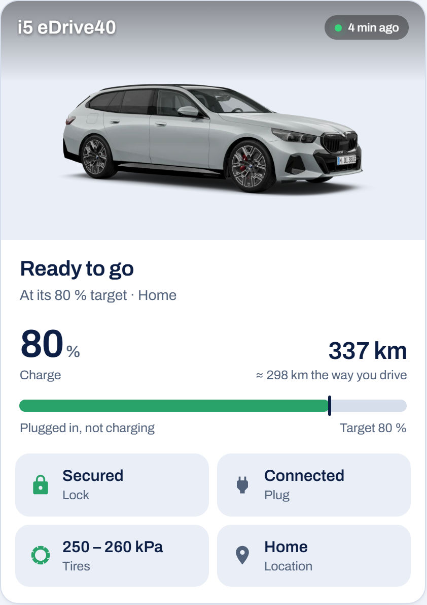
  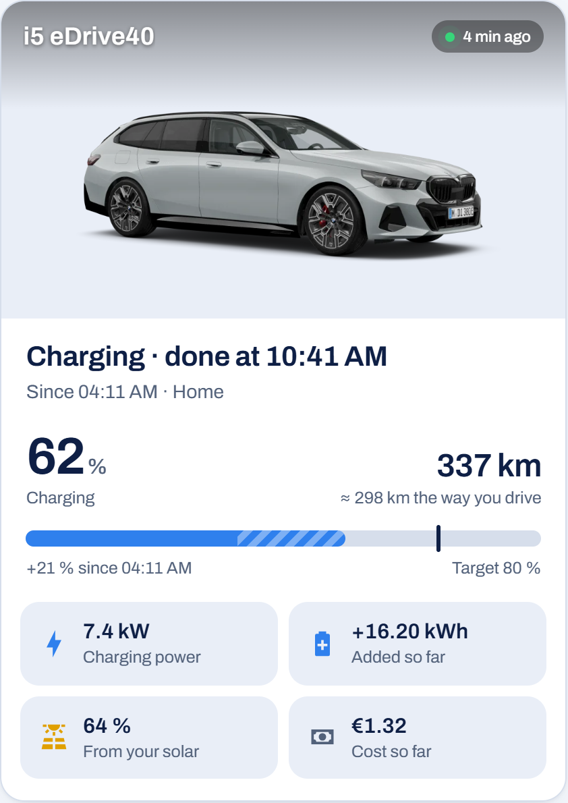
</p>

<p align="center">
  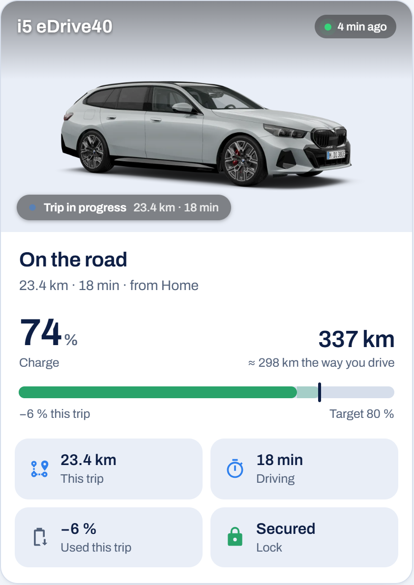
  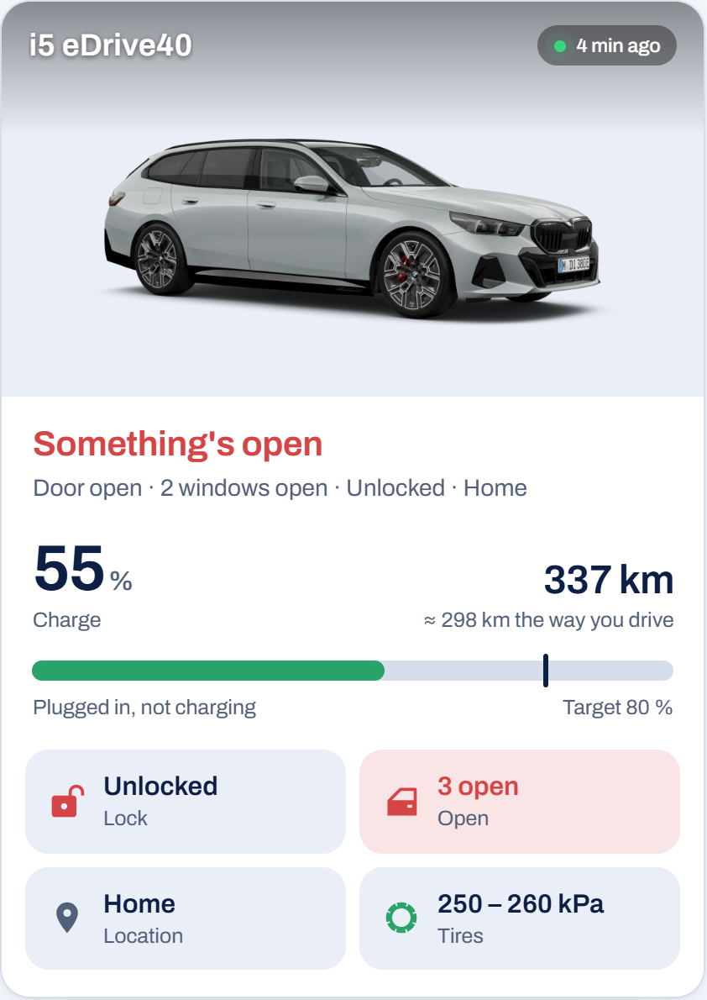
</p>

Was Balken und Kacheln zeigen, folgt dem **Antrieb** des Autos, den die Karte
aus den gestreamten Daten ableitet:

| Antrieb | Balken | Daneben |
| --- | --- | --- |
| Elektrisch | Ladestand, mit dem Ziel | Reichweite, darunter die echte Reichweite |
| Plug-in-Hybrid | Ladestand, mit dem Ziel, und der Tank als schmale zweite Linie mit der Gesamtreichweite | Elektrische Reichweite |
| Benzin / Diesel | Tankfüllstand, oder die Liter im Tank als Zahl, bei einem Auto, das keinen Prozentwert streamt | Reichweite |
| Keines, erwiesen | Kein Balken: die Reichweite ist die große Zahl | Kilometerstand |

Ein Benziner oder Diesel zeigt nichts zum Laden: kein Ziel, keinen Stecker,
keine Lade-Kacheln.

<p align="center">
  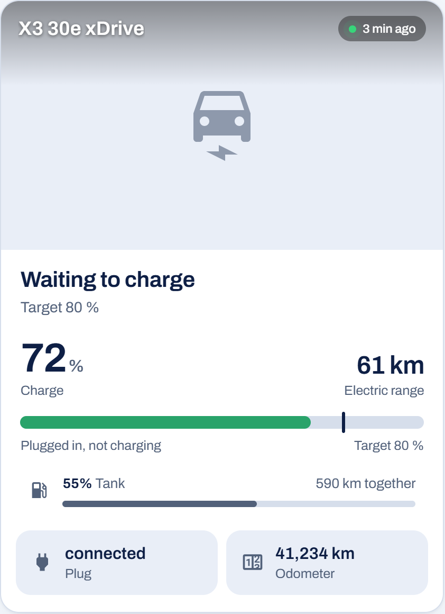
  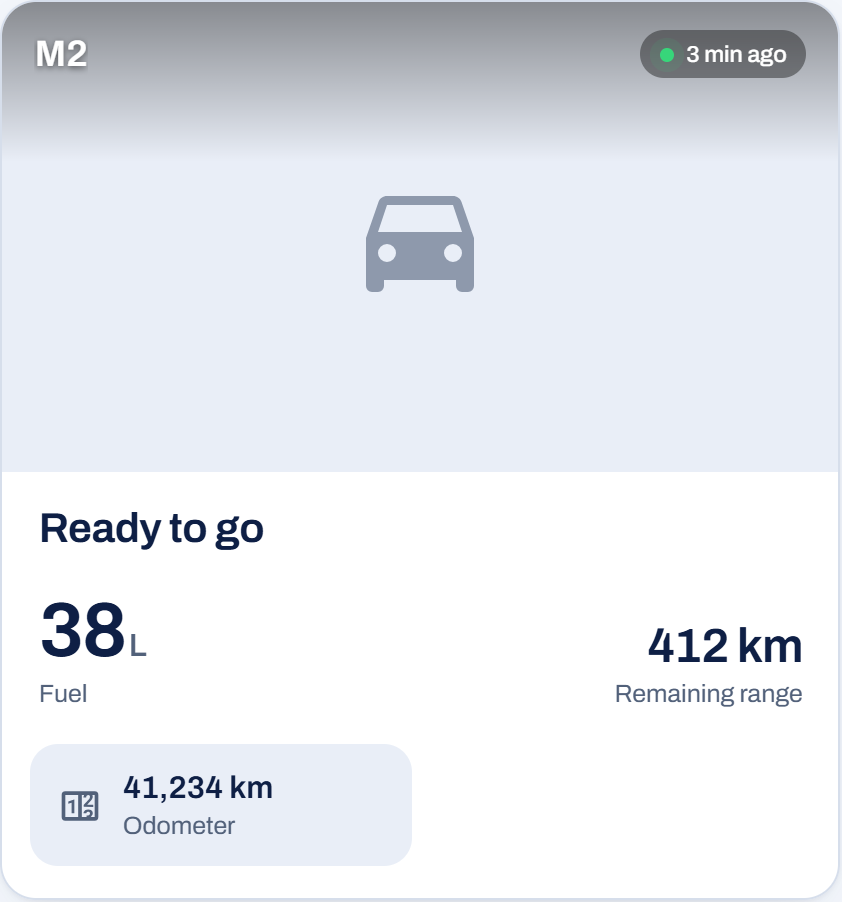
  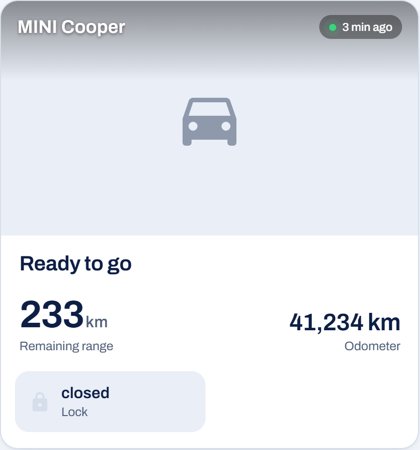
</p>

Ist **Konfigurieren → [Fahrzeugbild](DE-Settings-Reference#fahrzeugbild)** auf
BMWs Konfigurator gestellt, ist das Bild genau dein Auto, und Ziehen darüber (Maus
oder Finger) dreht es einmal ganz herum. Das Bild folgt auch dem Auto:

- **Licht und Tageszeit.** Nach Sonnenuntergang zu Hause zeigt es das Auto
  bei Nacht, in einem dunklen Raum mit einem Lichtkegel darunter, und solange
  das Auto sein Licht als eingeschaltet meldet (*Fahrzeuglicht-Zustand*), das
  Auto mit Licht. Das Auto selbst ist immer BMWs eigenes Bild: ein BMW so, wie
  BMW ihn nachts zeichnet, ein MINI beleuchtet wie in der Nachtszene von MINIs
  eigenem Konfigurator.
- **Wo es offen ist.** Solange etwas offen ist, erscheint die
  [Zeichnung von oben](#security--closures-cluster-closures) in der Ecke, mit dem
  offenen Teil hervorgehoben.
- **Innenraum.** Der Sitz-Knopf wechselt zu einem 360°-Panorama des Innenraums,
  in der unter [Konfigurieren → Fahrzeugbild → Polsterung](DE-Settings-Reference#fahrzeugbild)
  gewählten Polsterung (sonst BMW-Standard); zum Umsehen ziehst du darüber.

<p align="center">
  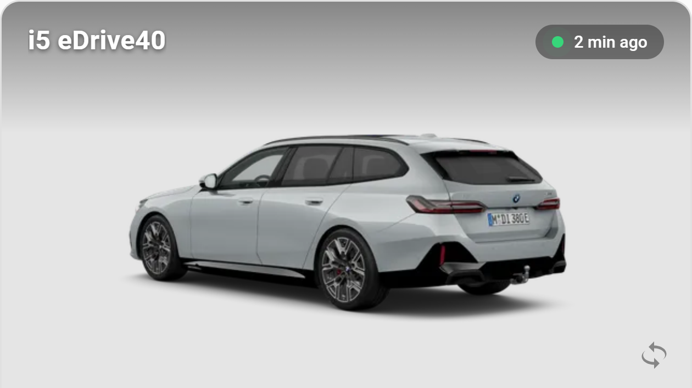
  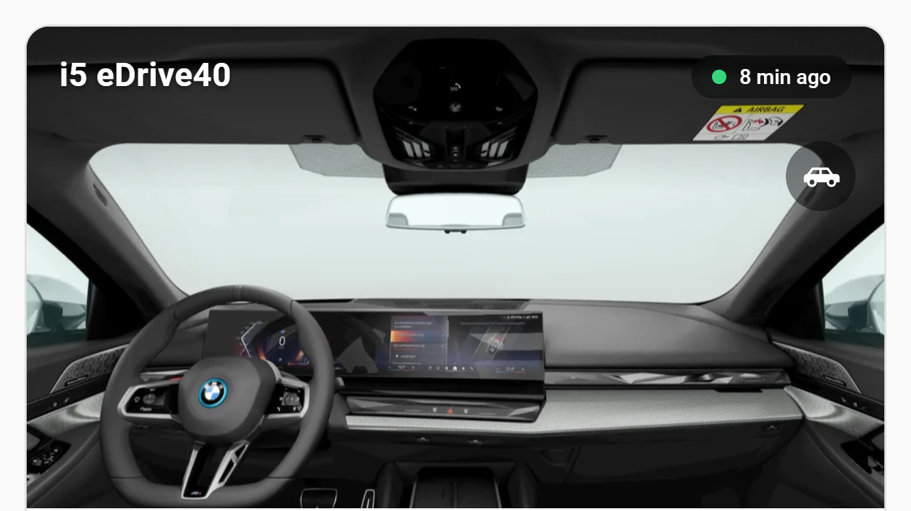
</p>

Die Karte merkt sich, wie weit du das Auto gedreht hast, ob du innen oder außen
warst und wohin du innen geschaut hast, sodass es nach dem Neuladen so dasteht,
wie du es verlassen hast. Das liegt in deinem Browser, jedes Gerät hat also
sein eigenes.

Der Ladestand im Balken ist die Schätzung der Integration. Steht das Auto, ist
das einfach BMWs letzter Messwert; lädt es, steigt sie mit der Rate weiter, die
die Ladeleistung ergibt — denn BMW kann mitten im Laden stundenlang schweigen, und
sein eigener Wert steht dann still. Mit einem verknüpften Wallbox-Zähler
[treibt zu Hause dieser die Schätzung](DE-Feature-evcc-and-Wallbox-Bridge#it-also-drives-the-state-of-charge-estimate).
Der nächste echte Messwert ersetzt sie. Siehe
[die Ladeseite](DE-Feature-Charging-History-and-Cost).

**Fertig um** in der Zeile oben und die Kachel **Bis voll** sind
[der eigene Wert der Integration](DE-Feature-evcc-and-Wallbox-Bridge#time-to-the-charge-target),
solange das Auto zu Hause mit verknüpftem Wallbox-Zähler lädt, und sonst BMWs.
Sie zeigen die Uhrzeit, zu der die Ladung fertig ist, als *05:40* (mit dem
Wochentag, wenn das nicht heute ist); antippen für die restlichen Minuten. Wird der Wert nicht mehr aktualisiert und ist
seine Uhrzeit schon vorbei, zeigt die Kachel stattdessen die Minuten.
Außerhalb einer Ladung heißt die Kachel *Ladezeit*, und sie wird ausgeblendet,
wenn diese 0 ist.

Zuerst entscheiden BMWs Basisdaten: Sie nennen den Antrieb als elektrisch,
Plug-in-Hybrid oder Verbrenner. Ohne sie ist ein Auto, das Daten der
Hochvoltbatterie *und* Kraftstoffdaten sendet, ein Plug-in-Hybrid; Kraftstoffdaten
allein machen es zum Benziner oder Diesel. Manche Benziner streamen trotzdem ein
E-Ladeziel, das lässt ein Auto aber nie elektrisch erscheinen. Ein Benziner, der
gar keinen Tank streamt, zeigt stattdessen seine Reichweite.

Ein frisch eingerichtetes Auto hat noch nichts bewiesen und behält so lange das
elektrische Layout. Ein Auto, das schon eine Weile sendet und **keine** der
beiden Datenarten geliefert hat, hat dagegen etwas bewiesen: Es ist nicht
elektrisch, was immer es sonst ist. Das kommt vor — ein MINI mit Benzinmotor
streamt unter Umständen weder Kraftstoffsystem noch Motor — und ihm einen
Ladestand zu zeigen, den er nie füllen kann, war schlicht falsch. Er bekommt
deshalb die letzte Zeile oben: Reichweite als große Zahl, Kilometerstand daneben, nichts
zum Laden. Wenn dein Auto dort landet und du es besser weißt, setze `drivetrain:`
in der YAML-Konfiguration der Karte.

```yaml
type: custom:bavariandata-card
```

Wählt sie das falsche Layout, setze im visuellen Editor **Antrieb**, oder:

```yaml
type: custom:bavariandata-card
drivetrain: ice   # bev · phev · ice — weglassen für automatische Erkennung
```

Die Ansichten Ladeverlauf und Effizienz beruhen auf Ladedaten, deshalb zeigen sie bei
einem Benziner oder Diesel stattdessen die [Kraftstoff-Ansicht](#fuel-view-fuel). Der
Batteriezustand sagt *Für dieses Fahrzeug gibt es hier nichts*, statt leer zu
bleiben, als wäre etwas kaputt. Wird das Auto doch geladen, setze **Antrieb**.

Während einer Fahrt erscheint unten am Bild zusätzlich ein Abzeichen **Fahrt aktiv**
mit Strecke und Minuten bisher; antippen für die vollständigen Attribute. Es folgt
der Entität *Fahrt aktiv* und bleibt daher nach der Ankunft noch ein paar Minuten
stehen — [warum](DE-Feature-Trips#seeing-the-drive-thats-happening-now).

Ein bestimmtes Fahrzeug legst du mit `device:` (Geräte-ID) oder `vin:` fest.

### Kacheln wählen

<a id="choosing-the-tiles"></a>

Die Kacheln können auch zeigen, was du willst. Wähle im Karten-Editor
**Kacheln**: zuerst die fertigen Kacheln, dann jede Entität des Autos. Zieh sie in
die gewünschte Reihenfolge. Leer lassen für Kacheln, die sich mit dem ändern, was
das Auto gerade tut.

<p align="center">
  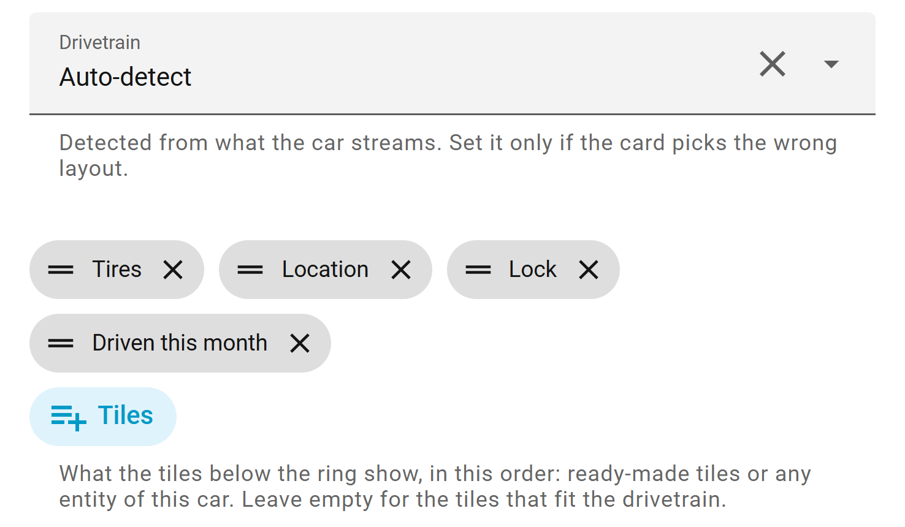
  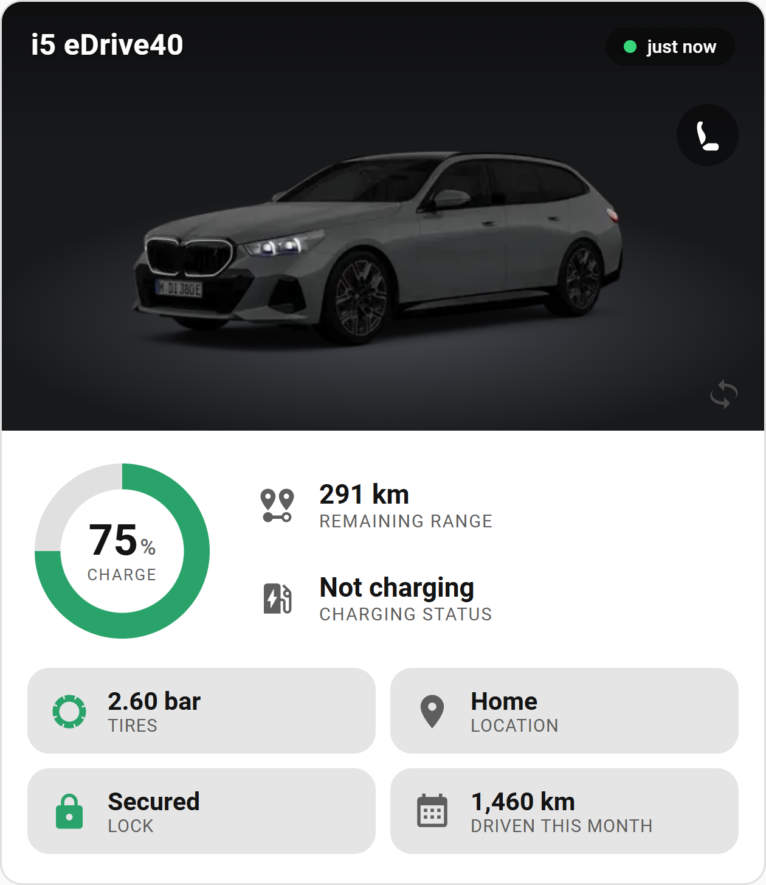
</p>

| Kachel | Zeigt |
| --- | --- |
| `odometer` | Den Kilometerstand |
| `tank` | Den Tankfüllstand oder den Tankinhalt |
| `total_range` | Die Reichweite mit Kraftstoff und Batterie zusammen (Plug-in-Hybride) |
| `target` | Das Ladeziel |
| `plug` | Ob das Kabel steckt |
| `time_to_full` | Wann die Ladung fertig ist (die Uhrzeit) |
| `tires` | Den niedrigsten und höchsten Reifendruck, grün, gelb oder rot wie in der [Reifen-Ansicht](#tires-cluster-tire) |
| `location` | Die Zone, in der das Auto steht, aus seinem Device Tracker |
| `lock` | Verriegelt, entriegelt oder gesichert |
| `distance_month` | Die diesen Monat gefahrene Strecke |
| `battery_12v` | Die 12-V-Batterie |

Jede Entität geht auch: Sie erscheint mit ihrem eigenen Namen, ohne den des Autos,
und ihrem eigenen Symbol. In YAML kann eine Kachel auch eigenen Namen und eigenes
Symbol tragen:

```yaml
type: custom:bavariandata-card
tiles:
  - tires
  - location
  - lock
  - sensor.x5_xdrive30d_coolant_temperature
  - entity: sensor.x5_xdrive30d_outside_temperature
    name: Außen
    icon: mdi:thermometer
```

Die Zeile oben, der Balken und die Reichweite daneben bleiben, wie das Auto sie
festlegt. Zeigt ein Benziner oder Diesel Lade-Kacheln, wurde sein Antrieb falsch
erkannt: Setze **Antrieb** (oben), statt die Kacheln zu ersetzen.

---

## Ladeverlauf (`view: charging`)

<a id="charging-history-view-charging"></a>

Jeder Monat beginnt mit seinen Zahlen: was geladen wurde, was es gekostet hat
(mit dem Preis je kWh zu Hause, *mindestens …*, wenn eine Ladung nicht voll
bepreist wurde) und wie
viele Ladungen, wie viele davon unterwegs. Darunter ein Balken, woher die
Energie kam (Sonne, Hausakku, Netz, unterwegs), und die kWh jedes Tages. Dann
die Ladevorgänge des Monats, neueste zuerst: Datum, der Ladestand von → bis als
kleiner Balken, ein Abzeichen Zuhause/Unterwegs, die Energie und darunter die
Kosten. Tippe einen Ladevorgang an für seine **Ladekurve** (mit dem Durchschnitt
als gestrichelter Linie), Spitzen- und Durchschnittsleistung, Dauer und
Netzenergie. Darunter nimmt **Bezahlt** an, was die Ladung laut Beleg gekostet
hat; das ersetzt den Betrag von BMW oder aus dem Tarif, bis du ihn **entfernst**
([siehe Eintragen, was eine Ladung gekostet hat](DE-Feature-Charging-History-and-Cost#eintragen-was-eine-ladung-gekostet-hat)).
Die Schaltflächen **CSV** und **Bericht** exportieren den
angezeigten Monat ([siehe Export](DE-Feature-Export)).

Eine laufende Ladung steht oben, solange sie läuft, mit dem, was sie bisher
gebracht und gekostet hat.

**Ein Monat nach dem anderen.** Wie in der Fahrten-Ansicht begrenzt ein Element
`‹ August 2026 ›` unter der Überschrift Zahlen und Liste auf einen
Kalendermonat; blättere zurück für ältere Ladevorgänge.

```yaml
type: custom:bavariandata-card
view: charging
```

<p align="center">
  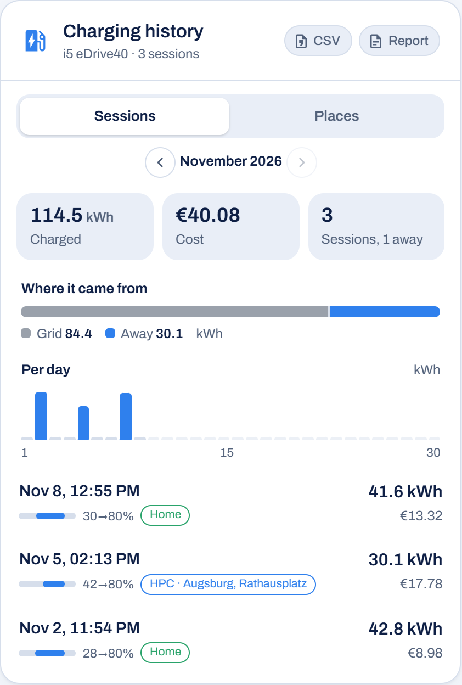
</p>

Sie liest den gespeicherten Verlauf über den Dienst `get_charging_sessions` und
verbraucht daher **kein API-Kontingent**. Kosten erscheinen erst, wenn unter
**Konfigurieren → Ladekosten & Verlauf** eine Preisquelle gesetzt ist
([siehe Ladeverlauf & Kosten](DE-Feature-Charging-History-and-Cost)); bis dahin
stehen die Ladevorgänge mit ihrer Energie da. Ein ohne GPS geladener Ladevorgang
trägt *Zuhause · angenommen*, einer, der bepreist wurde, während der Tarif kurz
unbekannt war, *Teilpreis*. Energie, die kein Sensor zuordnen konnte, auch die,
die eine Ladung während eines Neustarts von Home Assistant aufgenommen hat, steht
als *nicht zuordenbar* da, sodass *Woher es kam* die Ladungen des Monats ergibt.

**Orte.** Ein Schalter **Ladevorgänge | Orte** oben zeigt statt der Ladevorgänge
des Monats jeden Ort, an dem das Auto geladen hat: Besuche, AC oder DC, die
durchschnittliche Leistung und die typische Standzeit. Tippe auf einen Ort für
seinen besten Besuch, Minuten je 10 %, vorkonditioniert oder nicht und die
Leistungskurven seiner letzten Besuche übereinander. Mit **Ladeorte merken** zeigt
eine Landkarte, wo die Orte liegen. Orte umfassen den ganzen Verlauf, deshalb gibt
es dort keine Monatsauswahl
([siehe Ladeorte](DE-Feature-Charging-History-and-Cost#charging-places)).

Ist **Konfigurieren → Solar & Energiequellen** eingerichtet, trägt ein zuordenbarer
Ladevorgang zusätzlich ein Etikett **☀ 62 % Solar**, und aufgeklappt kommt eine Zeile
*Energiequelle* mit den kWh je Quelle hinzu
([siehe Woher die Energie kam](DE-Feature-Charging-History-and-Cost#where-the-energy-came-from)).
Ladevorgänge von vor der Einrichtung dieser Sensoren haben einfach kein Etikett — die
Karte zeigt nie 0 %, wenn es eigentlich „nicht gemessen“ heißt. Eine Ladung ganz ohne
Solarstrom (etwa nachts) hat ebenfalls kein Etikett; ihre Aufteilung zeigt trotzdem, woher
die Energie kam.

---

## Batteriezustand (`view: health`)

<a id="battery-health-view-health"></a>

Zeigt die gelernte nutzbare Kapazität als Anzeige (Prozent des Akkus im
Neuzustand) mit dem Verlauf der Kapazität über die Laufleistung darunter.

```yaml
type: custom:bavariandata-card
view: health
```

<p align="center">
  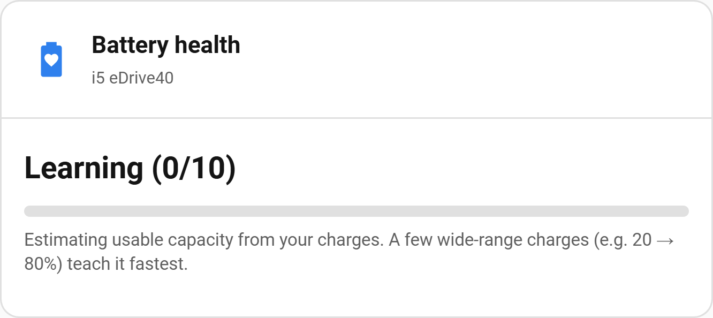
</p>

Sie liest den Sensor **Batteriezustand** und verbraucht daher **kein
API-Kontingent**. Bis genug Ladungen über einen weiten Bereich vorliegen, um sich des
Werts sicher zu sein, zeigt sie *Lernt (n/10)* statt einer springenden Zahl
([wie er gelernt wird](DE-Feature-Battery-Health)).

---

## Effizienz & Reichweite (`view: efficiency`)

<a id="efficiency--range-view-efficiency"></a>

Oben, wie weit das Auto mit der aktuellen Ladung wirklich kommt, verglichen mit
dem, was das Auto selbst sagt, und, sobald Fahrten ihr Wetter haben, mit mildem
Wetter; darunter der Verbrauch, auf dem dieser Wert beruht.

```yaml
type: custom:bavariandata-card
view: efficiency
```

<p align="center">
  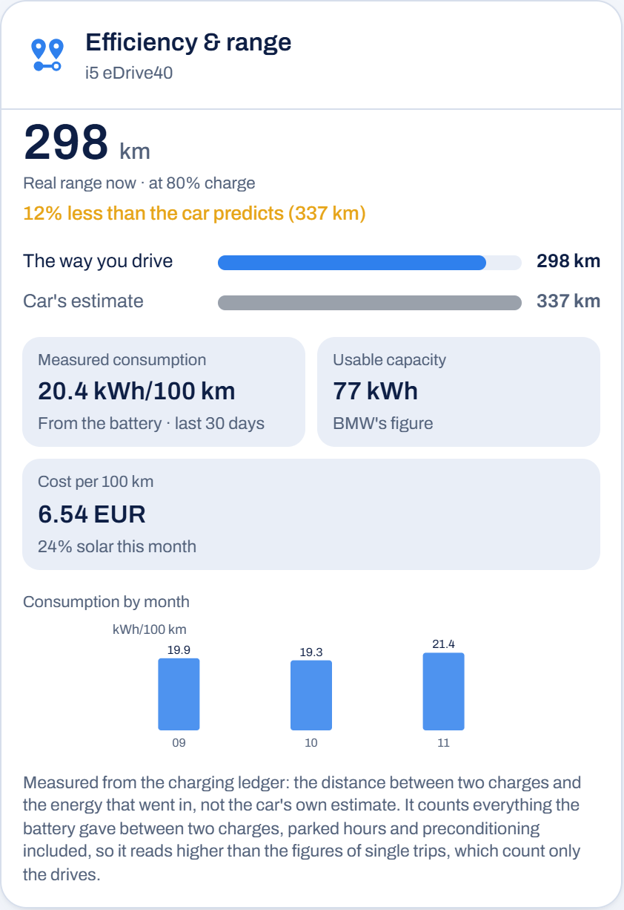
</p>

Sie zeigt die reale Reichweite von hier (und mit vollem Akku), mit Balken im
Vergleich zur Restreichweiten-Prognose des Autos und, mit Fahrtwetter, zu dem, was
dieselbe Ladung bei 15–25 °C schaffen würde, den gemessenen Verbrauch mit Seite des Ladegeräts
und Fenster, den gemessenen Ladeverlust, wo ein Netzwert existiert, die nutzbare
Kapazität, durch die geteilt wurde, deine Kosten pro 100 km mit dem Solaranteil des
Monats und ein Balkendiagramm des Verbrauchs nach Kalendermonat. Daran siehst du
die Jahreszeiten: Im Winter liegt der Verbrauch regelmäßig ein Drittel über dem
Sommer. Mit [Wetter entlang der Strecke](DE-Feature-Trips#weather-along-the-route-opt-in)
zeigt ein zweites Diagramm den Verbrauch je 5-°C-Band der Außentemperatur und wie viel
mehr das Auto unter 5 °C braucht als bei 15–25 °C, mit dem heutigen Band dort
markiert, wo das Auto steht
([wie](DE-Feature-Efficiency-and-Range#consumption-by-outside-temperature)); die
Details jeder Fahrt in der Fahrtenansicht zeigen dann auch ihre Außentemperatur.
Bei einem Plug-in-Hybrid gibt es keinen Verbrauch und keine Reichweite aus dem
Ladeverlauf ([warum](DE-Feature-Efficiency-and-Range#plug-in-hybride)); sie zeigt
stattdessen BMWs eigene Werte über die Lebensdauer — den elektrischen Verbrauch mit
Motor aus, den elektrisch gefahrenen Anteil, den Kraftstoff pro 100 km —, wo das Auto
sie sendet, und erklärt sonst, warum sie leer ist.

Alles wird aus dem Ladeverlauf gemessen — zwischen zwei Ladungen liegen eine
Strecke und die Energie, die dafür nachgeladen wurde —, daher verbraucht sie **kein API-Kontingent** und
übernimmt nie die Prognose des Autos
([wie gemessen wird](DE-Feature-Efficiency-and-Range)). Deshalb liegt er auch
höher als der Wert der Fahrten-Ansicht: Er zählt alles, was der Akku zwischen zwei
Ladungen hergegeben hat, Standzeiten und Vorklimatisierung eingeschlossen, eine
Fahrt dagegen nur die Fahrt. Beide bleiben, jeder beschriftet.

Bis der Ladeverlauf rund 50 km Fahrt einschließt, sagt die Karte das, statt eine Zahl
zu zeigen.

---

## Kilometer (`view: mileage`)

<a id="mileage-view-mileage"></a>

Wie viel das Auto gefahren wird und, falls es eine hat, wie es zu einer
Kilometergrenze aus Leasing oder Versicherung steht.

```yaml
type: custom:bavariandata-card
view: mileage
```

<p align="center">
  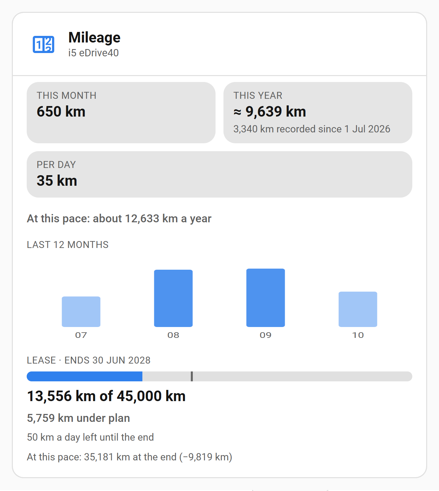
</p>

Sie zeigt diesen Monat, dieses Jahr und den Schnitt pro Tag, das Jahrestempo
daraus und einen Balken pro Monat für die letzten zwölf. Begann die Aufzeichnung
erst in diesem Jahr, ist *dieses Jahr* in deinem Tempo geschätzt, mit der
aufgezeichneten Strecke darunter. Das Tempo wartet auf vier Wochen
Kilometerstände. Mit einem
[Kilometerkontingent](DE-Feature-Mileage#a-mileage-allowance) zeigt ein Balken,
wie viel davon verbraucht ist, mit einer Markierung, wo der Plan heute steht;
darunter unter oder über Plan, die Strecke pro Tag bis zum Ende und wo das
aktuelle Tempo landet. Ohne Kontingent sagt eine Zeile, wo man es einträgt.

Alles kommt aus den täglichen Kilometerständen des Autos, kostet daher **kein
API-Kontingent** und funktioniert mit jedem Antrieb. Strecken folgen der Einheit
des Kilometerzählers (km oder mi).

---

## Kraftstoff (`view: fuel`)

<a id="fuel-view-fuel"></a>

Die Tankvorgänge eines Benziners, Diesels oder Plug-in-Hybrids und was er dazwischen
verbraucht. Bei einem Benziner oder Diesel zeigen die Ansichten Ladeverlauf und
Effizienz das ebenfalls.

```yaml
type: custom:bavariandata-card
view: fuel
```

Sie zeigt den Tank jetzt (Liter oder Prozent, mit der Reichweite), den
Durchschnittsverbrauch der letzten 12 Monate, Strecke und Kraftstoff seit dem letzten
Tanken und BMWs eigenen Wert über die Lebensdauer, wo das Auto seine OBFCM-Zähler
sendet. Darunter jeder Tankvorgang: wann, der Kilometerstand, wie viel hineinging und
der Verbrauch auf der Strecke, die er abgeschlossen hat.

<p align="center">
  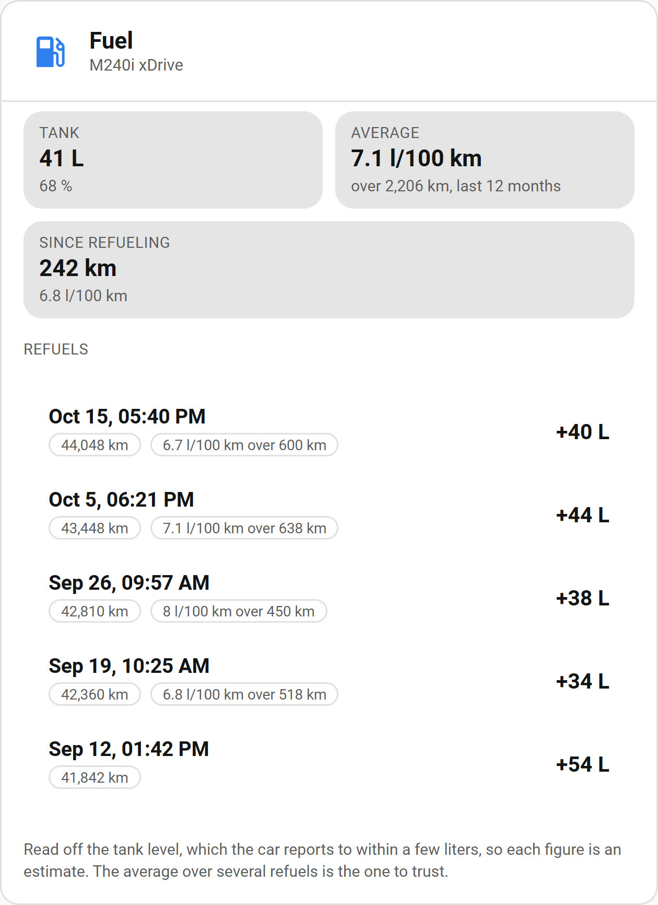
</p>

Es gibt keinen Tankbeleg zum Ablesen, deshalb erkennt die Karte einen Tankvorgang am
Tank selbst: ein Anstieg um mindestens 5 L (8 % bei einem Auto, das nur Prozent
streamt), während das Auto steht. Zwischen zwei Tankvorgängen ist das, was der Tank
über die Kilometer des Zählers verloren hat, der Verbrauch, gezeigt für Strecken ab
150 km. Das Auto meldet seinen Tankinhalt auf ein paar Liter genau, eine einzelne
Strecke kann also um etwa einen Liter pro 100 km danebenliegen; verlässlich ist der
Durchschnitt über mehrere. Ein Auto, das nur Prozent sendet, bekommt seine
Tankvorgänge aufgelistet, aber kein l/100 km, weil sich Prozent ohne die Tankgröße
nicht in Liter umrechnen lassen.

Das Protokoll beginnt mit dem Tag des Updates, der erste Wert braucht also zwei
Tankvorgänge. Es verbraucht **kein API-Kontingent**
([Dienst](DE-Services-Reference#get_fuel_history)). Der Verbrauch steht immer in
l/100 km, Strecken folgen der Einheit des Kilometerzählers.

---

## Fahrten / Fahrtenbuch (`view: trips`)

<a id="trips--driving-journal-view-trips"></a>

Listet deine aufgezeichneten Fahrten Monat für Monat, jeden Tag unter einer
eigenen Überschrift mit der Strecke des Tages. Eine Fahrt zeigt *von → nach*,
ihre Art als farbigen Punkt (geschäftlich, privat, Pendeln), Uhrzeit, Dauer und
das Wetter unterwegs, und ihre Strecke mit dem Verbrauch daneben: grün, wenn sie
weniger brauchte als der Monatsdurchschnitt, gelb, wenn mehr. Tippst du eine an,
siehst du Verbrauch, Rekuperation und verbrauchten Ladezustand, kannst sie
anders einstufen und — bei Fahrten, die mit **Route aufzeichnen** gespeichert
wurden — eine kleine Karte der Route sehen (als saubere Linie mit Start- und
Zielmarkierung; zum Zeichnen verlässt nichts deinen Browser).

Über der Liste fasst eine **Monatsübersicht** die Strecke (mit Differenz zum
Vormonat), die Aufteilung geschäftlich/privat/Pendeln, den Durchschnitt der
Fahrten, die rekuperierte Energie, eine Fahrstil-Bewertung und die häufigsten
Ziele zusammen — und, sobald ein Tarif gesetzt ist, geschätzte Fahrtkosten.
Tippe eine Art in der Aufteilung an, um nur diese Fahrten zu listen; nochmal
antippen für alle.

Ein Schalter **Liste | Karte** oben öffnet die [Fahrtenkarte](#trip-map-view-map)
in derselben Karte.

**Ein Monat nach dem anderen.** Ein Element `‹ August 2026 ›` unter der Überschrift
begrenzt Liste, Monatsübersicht und die Schaltflächen **CSV** / **Bericht** auf einen
Kalendermonat. Blättere zurück für ältere Datensätze — der Verlauf wird standardmäßig
zwei Jahre aufbewahrt
([Aufbewahrung](DE-Settings-Reference#charging-costs--history)), weit mehr, als ein
Bildschirm auf einmal zeigen sollte. Vorwärts geht es bis zum aktuellen Monat.

> Der **Durchschnittsverbrauch** wird aus dem Ladeverlauf und dem Kilometerstand
> gemessen, nicht aus den Fahrten, und ist mit **ab Akku** oder **ab Steckdose**
> beschriftet, je nachdem, wo die Energie tatsächlich gemessen wurde — ab Steckdose
> nur, wenn jede Ladung einen gemessenen Netzwert hat; dann erscheint darunter der
> batterieseitige Wert mit dem Ladeverlust dazwischen. Siehe
> [wie der Verbrauch gemessen wird](DE-Feature-Trips#how-consumption-is-measured).

Eine laufende Fahrt **steht an der Spitze der Liste**, mit einem Live-Abzeichen und
einem farbigen Rand: woher du losgefahren bist, Strecke und Zeit bisher und — mit
**Route aufzeichnen** — die wachsende Route. Sie hat keine Schaltflächen zum
Zuordnen, weil es bis zu ihrem Ende keine gespeicherte Fahrt gibt
([Details](DE-Feature-Trips#seeing-the-drive-thats-happening-now)).

```yaml
type: custom:bavariandata-card
view: trips
```

<p align="center">
  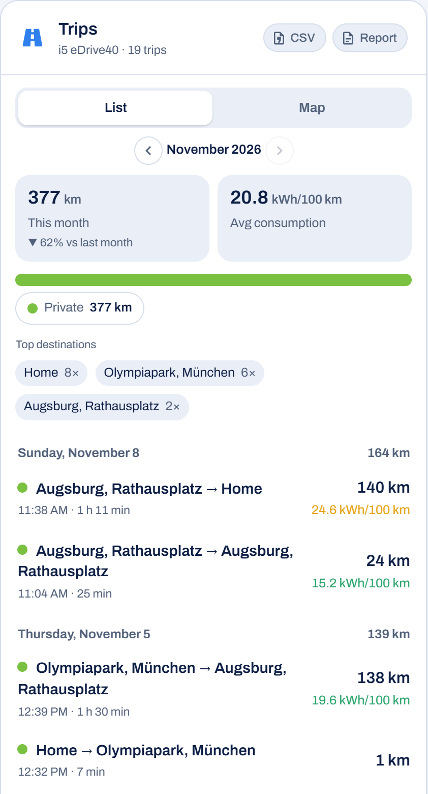
  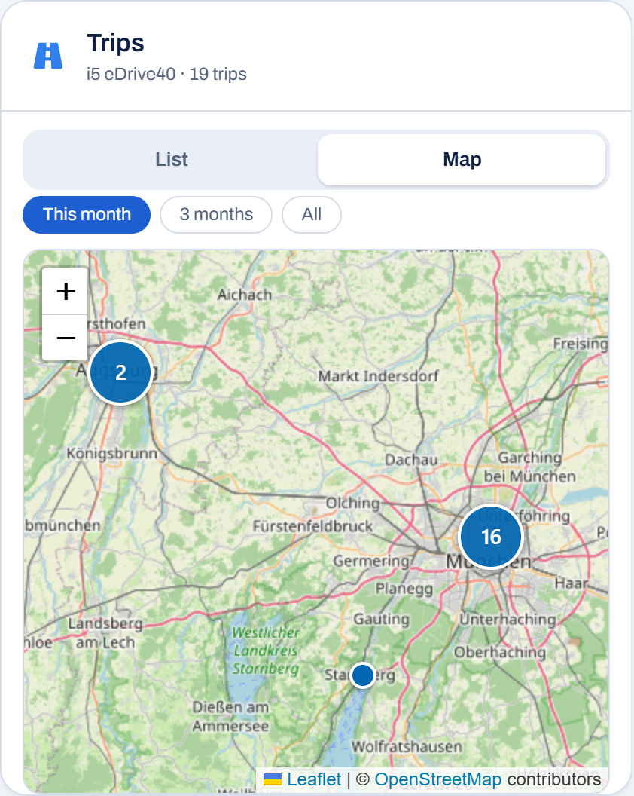
</p>

Sie liest die Dienste `get_trips` und `get_driving_summary` und verbraucht daher
**kein API-Kontingent**. Fahrten werden aus dem Stream rekonstruiert — keine
Konfiguration nötig. Endpunkte werden als **Ortsnamen** gespeichert, nie als
Koordinaten. Lege unter **Konfigurieren → Fahrten** eine **Arbeitszone** fest, damit
Fahrten Zuhause↔Arbeit als Pendelfahrten erkannt werden
([siehe Fahrten](DE-Feature-Trips)).

> Das ist ein Fahrtenbuch und eine Hilfe für Spesen — **kein Finanzamt-konformes
> Fahrtenbuch**: Es ist rechtlich nicht manipulationssicher.

---

## Fahrtenkarte (`view: map`)

<a id="trip-map-view-map"></a>

Eine **Zielkarte**: Sie zeigt, wo deine Fahrten **enden**, und diese Markierungen
**fassen sich beim Herauszoomen zu gezählten Blasen zusammen und teilen sich beim
Hineinzoomen auf** — ein schneller Blick darauf, wohin du am häufigsten fährst. Gezeigt
wird nur das Ende jeder Fahrt (der Start einer Fahrt ist das Ende der vorigen, beides zu
zu zeigen, würde doppelt zählen), was eine ehrliche Zählung „so oft hier angekommen“ ergibt.
Klicke auf eine Blase, um hineinzuzoomen. Eine Leiste wechselt den Zeitraum — **Dieser
Monat** (Standard), **3 Monate** oder **Alle**.

Die Ansicht [Fahrten](#trips--driving-journal-view-trips) zeigt dieselbe Karte im
Reiter **Karte**; `view: map` ist die Karte allein. Die *Route* einer bestimmten
Fahrt siehst du in der Liste der Fahrten-Ansicht, wenn du diese Fahrt aufklappst —
dort wird sie auf einer kleinen Karte gezeichnet.

```yaml
type: custom:bavariandata-card
view: map
```

<p align="center">
  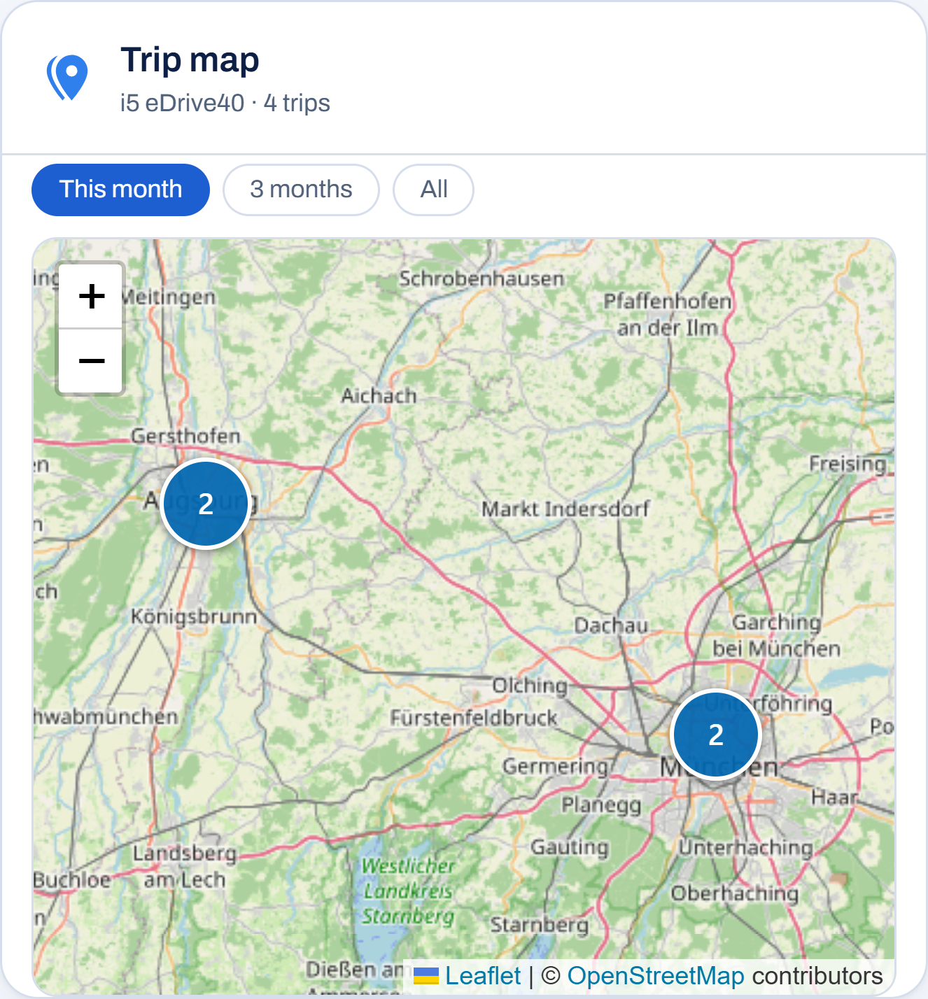
</p>

Die Karte hat erst etwas zu zeigen, wenn du unter **Konfigurieren → Fahrten** **Route
aufzeichnen** einschaltest — diese optionale Einstellung speichert die GPS-Koordinaten
jeder Fahrt (die einzige Stelle, an der die Integration rohe Koordinaten auf der
Festplatte behält, und **standardmäßig aus**). Ist sie aus oder gab es noch keine Fahrt
damit, erklärt die Ansicht, dass noch keine Orte aufgezeichnet sind. Fahrten von
*vor* dem Einschalten haben keine Koordinaten, die sich eintragen ließen.

Sie liest die Endpunkte über den Dienst `get_trips`, verbraucht also **kein
API-Kontingent**, und nutzt Home Assistants eigene Kartenkomponente samt
Markierungs-Gruppierung (die Kartenkacheln kommen von OpenStreetMap, wie bei der
eingebauten Kartenkarte).

> **Privatsphäre:** Anders als der Rest des Verlaufs — der Orts*namen* speichert, nie
> Koordinaten — nutzt diese Ansicht die aufgezeichneten Koordinaten deiner
> Fahrt-Endpunkte, dein Zuhause eingeschlossen. Schalte die Routenaufzeichnung nur ein,
> wenn dir das recht ist, und denk daran, dass die Karte jeder sieht, der das Dashboard
> sehen kann.

---

## Das Auto (`view: car`)

<a id="the-car-view-car"></a>

Alles über das Auto selbst in einer Karte. Oben sagt ein Banner das Dringendste
(etwas offen, ein Reifen zum Prüfen, eine Check-Control-Meldung) oder *Alles in
Ordnung*, mit dem, was das umfasst. Darunter die eigene
[Zeichnung von oben](#the-cars-shape) mit allem Offenen hervorgehoben und jedem
Reifen nach Zustand eingefärbt, an den Ecken die vier Drücke: Tippe einen an für
Größe, Profil, Saison, Montagedatum und Restlaufzeit dieses Reifens.

Darunter je eine Zeile, wo das Auto die Daten hat: Türen und Schloss, Check
Control (frühere Meldungen eingeklappt), die Service-Punkte mit Fälligkeit nach
Datum oder Strecke, die 12-V-Batterie, der [Batteriezustand](#battery-health-view-health)
und dein [Leasing- oder Jahreskilometerlimit](DE-Feature-Mileage#a-mileage-allowance).
Tippe eine Zeile an für ihre Entität.

```yaml
type: custom:bavariandata-card
view: car
```

<p align="center">
  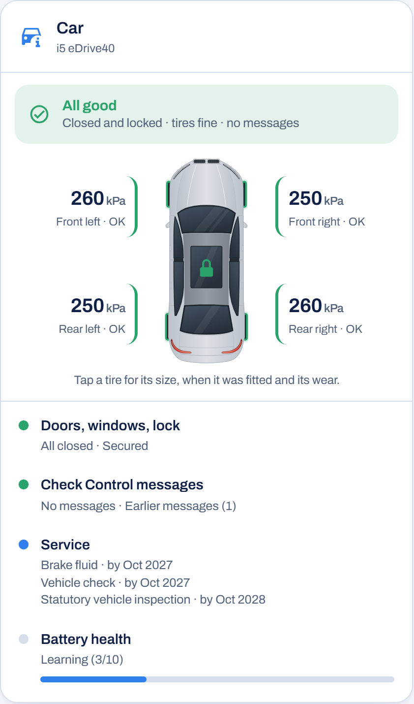
</p>

Die Karten [Reifen](#tires-cluster-tire), [Öffnungen](#security--closures-cluster-closures),
[Batteriezustand](#battery-health-view-health) und [Kilometer](#mileage-view-mileage)
bleiben, wie sie sind, für ein Dashboard, das eine davon allein zeigen will. Sie
liest nur die Sensoren des Autos und den Kilometerbericht und verbraucht daher
**kein API-Kontingent**.

---

## Reifen (`cluster: tire`)

<a id="tires-cluster-tire"></a>

Zeichnet ein Auto von oben mit jedem Reifen nach Zustand eingefärbt, oben eine
Zusammenfassung des ganzen Satzes und daneben die Werte und die Bereifung jedes Rads.

<p align="center">
  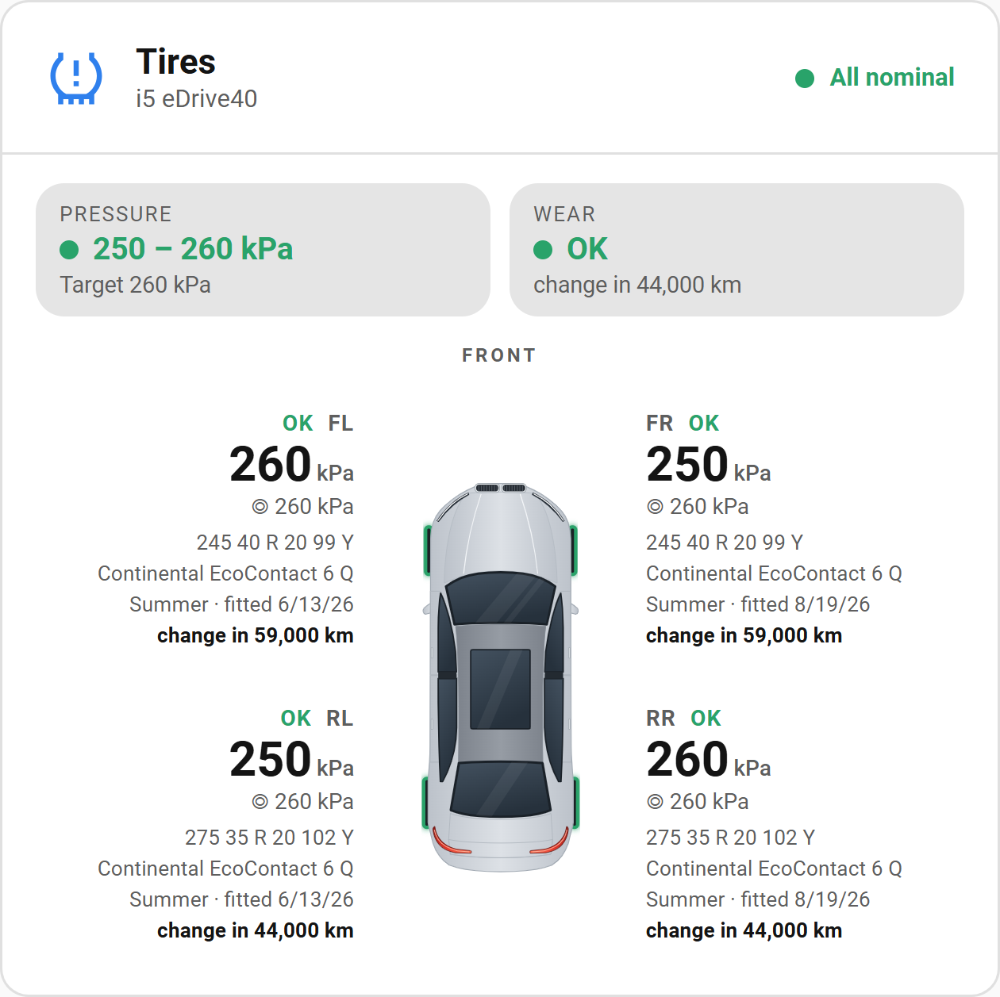
</p>

```yaml
type: custom:bavariandata-card
cluster: tire
```

**Die Zusammenfassung** oben hält die zwei Dinge, die an einem Reifen falsch sein
können, nebeneinander: **Druck** (die gemessene Spanne im Satz, mit dem gemeinsamen
Sollwert darunter) und **Verschleiß** (BMWs Urteil, mit der Laufleistung, bis das
erste Rad fällig ist). Das Abzeichen in der Überschrift ist das Gesamturteil für das
ganze Auto.

**Der Druck** kommt aus dem Stream und wird am eigenen Sollwert jedes Rads gemessen.
Das Band ist bewusst schief — niedrig ab 8 % unter Soll, hoch erst über 15 % über Soll
—, weil der Sollwert ein *Kalt*druck ist und ein gerade gefahrener Reifen 8–10 % höher
liegt, ohne dass etwas falsch ist.

**Der Verschleiß** kommt aus BMWs Reifendiagnose (Smart Maintenance), erneuert durch
die [tägliche Aktualisierung](DE-Feature-API-Quota#the-daily-refresh). Ist sie
verfügbar, zeigt jedes Rad außerdem Größe, Profil, Saison, Montagedatum und die
Laufleistung bis zum Wechsel. Das ist absichtlich pro Rad: Mischbereifung
(unterschiedliche Größen vorne und hinten) ist normal, und eine einzige Zeile unter dem
Diagramm müsste sich für eine entscheiden.

Verschleiß geht in Farbe und Überschrift vor Druck: Ein Reifen, den BMW als abgefahren
meldet, zeigt *„Reifen prüfen“* auch bei perfektem Druck, denn Druck ist leicht zu
beheben, Profil nicht. Hat dein Auto keinen Reifen-Servicedatensatz, liefert BMW hier
nichts, die Verschleiß-Teile fehlen einfach und die Karte zeigt nur den Druck.

In einer schmalen Dashboard-Spalte fällt das Autodiagramm weg und die vier Räder
ordnen sich als 2×2-Raster, vordere Reihe über der hinteren.

---

## Sicherheit & Öffnungen (`cluster: closures`)

<a id="security--closures-cluster-closures"></a>

Zeigt Türen, Fenster, Motorhaube, Kofferraum, Schiebedach, Zentralverriegelung und
Diebstahlwarnanlage auf demselben Autodiagramm. Offene Türen leuchten rot, offene
Fenster und Schiebedach gelb, und ein Schloss in der Mitte zeigt den
Verriegelungszustand — gelesen aus dem gestreamten **Zustand der Türen**, sodass es
dem echten Schloss folgt statt dem veralteten REST-Wert *Status der Türen*
([warum](DE-Feature-Entities-and-Devices#which-lock-entity-to-use)); ein Abzeichen fasst
den ungünstigsten Zustand zusammen, und jedes Teil führt beim Antippen zur zugehörigen
Entität. Teile, die das Fahrzeug nicht meldet, werden einfach weggelassen.

<p align="center">
  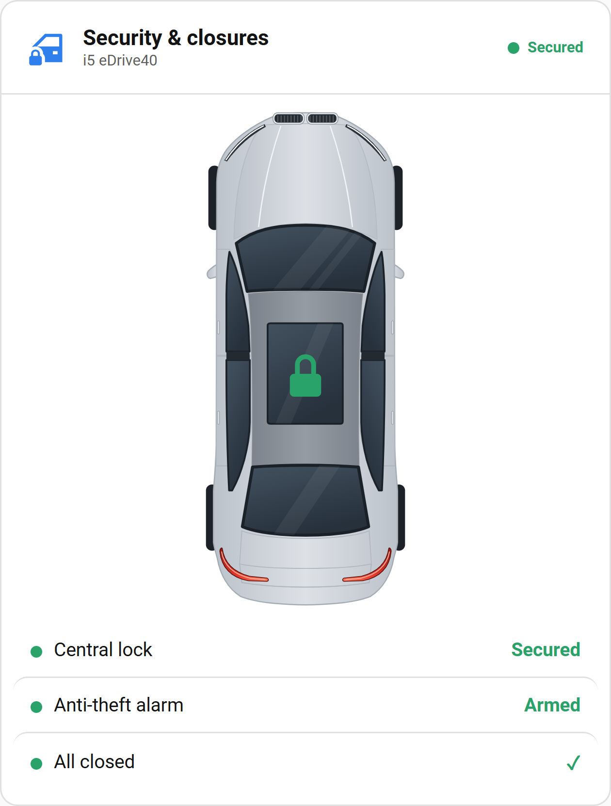
</p>

```yaml
type: custom:bavariandata-card
cluster: closures
```

BMW meldet die seitlichen Türen und Fenster nach Sitzplatz (Fahrertür,
Beifahrertür), nicht nach Seite. Die Karte ordnet sie deshalb nach der
Lenkradseite des Autos zu, die sie aus BMWs Fahrzeugbasisdaten liest. Bei einem
Rechtslenker erscheint die Fahrertür also rechts. Landen sie auf der falschen
Seite, setze im visuellen Editor **Lenkrad**, oder:

```yaml
type: custom:bavariandata-card
cluster: closures
steering: right   # left · right — weglassen, um es aus BMWs Fahrzeugdaten zu lesen
```

<p align="center">
  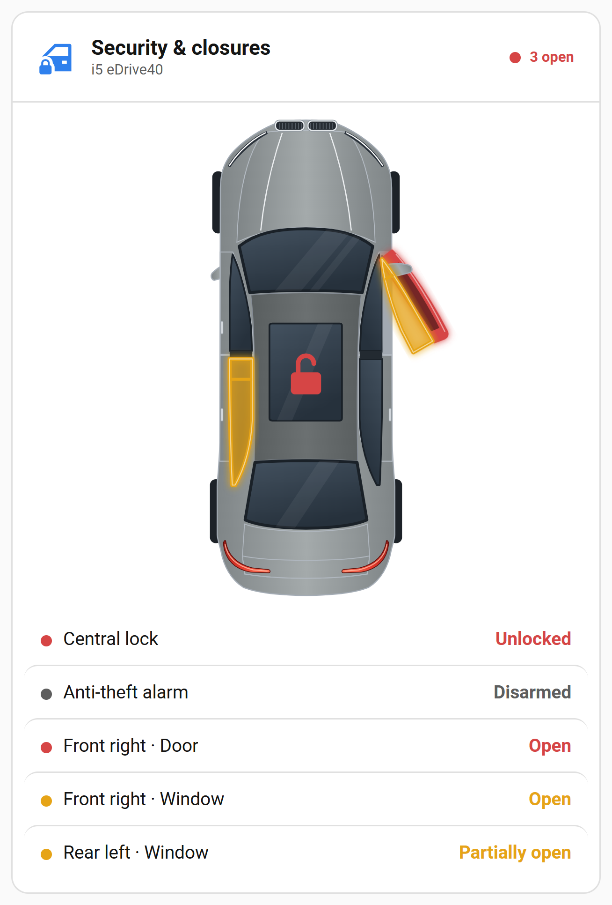
</p>

### Die Form des Autos

<a id="the-cars-shape"></a>

Die Reifen- und die Öffnungs-Ansicht zeichnen eine BMW-Limousine, außer bei einem
**MINI Countryman**: Der bekommt eine eigene Zeichnung, kantiger, mit
einer Motorhaube, die die ganze Front umfasst, Dachreling und zweiteiligem Glasdach. Die
Karte erkennt ihn am Modellnamen in BMWs Fahrzeugbasisdaten, einzustellen gibt es
nichts. Um eine Form zu erzwingen, setze im visuellen Editor **Fahrzeugform**,
oder:

```yaml
type: custom:bavariandata-card
cluster: closures
shape: countryman   # sedan · countryman — weglassen, um sie aus BMWs Fahrzeugdaten zu wählen
```

<p align="center">
  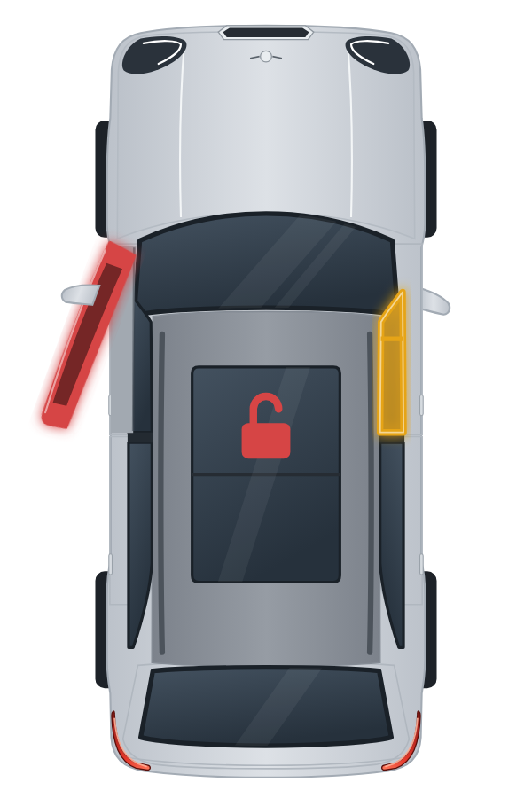
</p>

Andere Modelle, auch die übrigen MINIs, bekommen vorerst die Limousine.

Ist **Konfigurieren → [Fahrzeugbild](DE-Settings-Reference#fahrzeugbild)** auf
BMWs Konfigurator gestellt, trägt die Zeichnung die echte Lackfarbe deines Autos,
abgelesen am Bild des Konfigurators. Für einen MINI hat BMW auch ein echtes Foto
von oben, das die Reifen-Ansicht dann statt der Zeichnung zeigt (die
Reifenwerte bleiben in ihren Ecken). Für kein BMW-Modell gibt es eine solche
Ansicht.

---

## Ausstattung (`view: equipment`)

<a id="equipment-view-equipment"></a>

Die Werksausstattung des Autos, mit Namen: zuerst Lack, Räder und Leisten, dann
die Pakete, dann jede weitere Option, mit der das Auto gebaut wurde, jeweils mit
BMWs Code. Was BMW als technisch behandelt (Kältemittel, die Sprache der
Unterlagen, Abgassteuerung), ist unter **Technische Codes** eingeklappt.
Optionen, für die BMW ein Bild hat, zeigen es vor dem Namen: ein Farbmuster für
Lack, Räder und Dach, ein kleines Foto für den Rest. Die meisten technischen
Codes haben keins. Für eine reine Liste schalte im Karten-Editor **Bilder der
Optionen zeigen** aus (`pictures: false`).

```yaml
type: custom:bavariandata-card
view: equipment
```

<p align="center">
  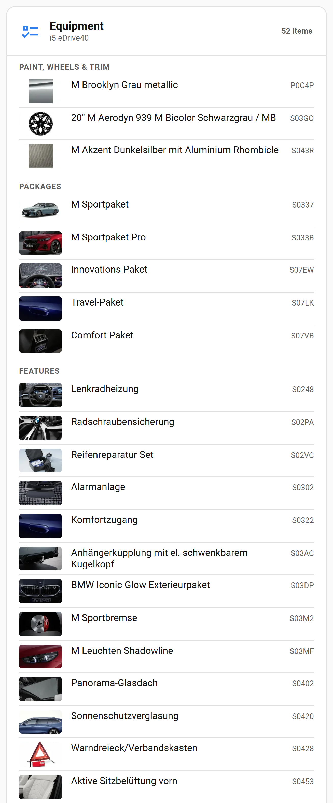
</p>

Dafür muss **Konfigurieren → [Fahrzeugbild](DE-Settings-Reference#fahrzeugbild)**
auf BMWs Konfigurator stehen, der die Codes aus BMWs Fahrzeug-Basisdaten
benennt; bis dahin sagt die Karte das. Die Namen sind BMWs eigene, in der
Sprache, die BMWs Markt für dein Auto anbietet: Englisch, wo es das gibt, sonst
die Sprache des Marktes. Fehlt dein Modell in BMWs Daten für deinen Markt,
springt ein anderer Markt mit derselben Sprache ein.

---

## Liste einer Datengruppe

<a id="single-cluster-list"></a>

Setze `cluster:`, um jeden Wert einer Datengruppe des Katalogs aufzulisten. Nutze eine
Karte pro Datengruppe:

```yaml
type: custom:bavariandata-card
cluster: electric   # electric · status · tire · usage · events · basic · contract · metadata · other
```

Die Karte gruppiert Entitäten über ihre **Attribute** `cluster`/`category`, nicht über
ihre Namen — sie funktioniert also unabhängig von der Sprache in Home Assistant.

`cluster: events` zeigt zuerst die **Check-Control-Meldungen** des Fahrzeugs — die
Warnungen, die das Auto selbst im Display anzeigt, etwa zu wenig Waschwasser — und
sagt es, wenn keine vorliegen. Tippe auf eine Meldung, um sie aufzuklappen: der
Kilometerstand, bei dem das Fahrzeug sie zuletzt angezeigt hat, wie lange es her
ist, dass das Fahrzeug sie gesendet hat, und BMWs Meldungscode. Der Text erscheint so, wie BMW ihn sendet, also auf
Englisch, egal welche Sprache eingestellt ist. Eine Meldung, die das Fahrzeug nicht
mehr meldet — das Waschwasser ist nachgefüllt —, verlässt die Liste und wandert unter
**Frühere Meldungen**, zugeklappt, bis du darauf tippst, mit dem Tag, an dem sie
zuletzt gemeldet wurde, und dem, seit dem sie fehlt. Das Fahrzeug sendet seine
Meldungen beim Losfahren, und die Integration liest sie einmal am Tag — eine
erledigte Warnung kann also bis zu einem Tag und eine Fahrt brauchen, bis sie
wandert. Die Meldungen stammen vom Sensor
*Check Control Meldungen*, den BMW unter den nutzungsbasierten Daten führt; BMWs
eigene Datengruppe *Fahrzeugereignisse* enthält nur zwei Teleservice-Zeitstempel,
die unter den Meldungen stehen, wenn das Fahrzeug sie sendet.

<p align="center">
  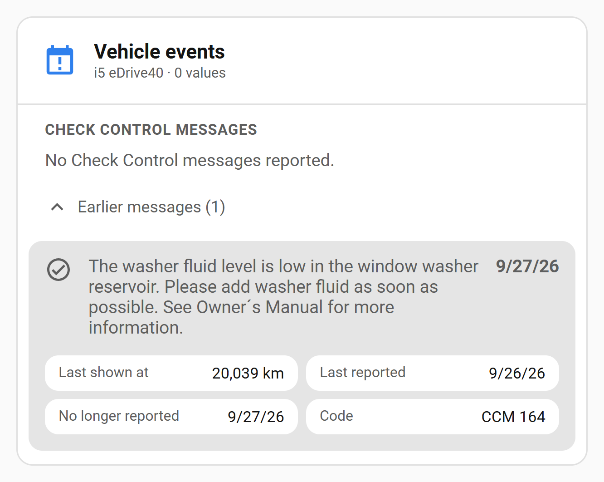
</p>

---

## Der Hub (`hub: true`)

<a id="the-hub-hub-true"></a>

Die Übersicht kann die anderen Ansichten als Bereiche unter sich tragen.
Schalte im visuellen Editor **Bereiche unter der Übersicht** ein, oder:

```yaml
type: custom:bavariandata-card
hub: true
```

Unter den Kacheln sagt je eine Zeile, was der Bereich als Erstes sagen würde:
**Laden** (kWh und Kosten dieses Monats), **Fahrten** (Strecke und Zahl der
Fahrten dieses Monats), **Effizienz** (echte Reichweite und Verbrauch) und
**Auto** (alles in Ordnung, oder was nicht: etwas offen, ein Reifen, eine
Check-Control-Meldung; sonst der nächste Service). Ein Benziner oder Diesel
zeigt **Kraftstoff** (letztes Tanken und Durchschnitt) statt Laden und
Effizienz, ein Plug-in-Hybrid zeigt es nach Laden; ein Auto ohne erkannten
Antrieb zeigt Fahrten und Auto. Während das
Auto lädt, sagt das die Zeile Laden, mit dem, was diese Ladung schon gebracht
hat; auf einer Fahrt die Zeile Fahrten.

Tippst du eine Zeile an, öffnet sich der Bereich in derselben Karte, genau so
gezeichnet wie seine eigene `view:`-Karte, mit einem Pfeil oben zurück zur
Übersicht. Die Karte merkt sich nichts: Nach dem Neuladen beginnt sie auf der
Übersicht. Ohne `hub: true` bleibt die Übersicht, wie sie ist, und jede
`view:`-Karte funktioniert wie bisher für sich.

<p align="center">
  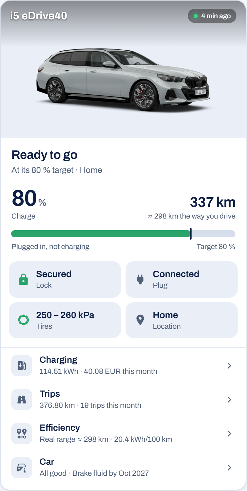
  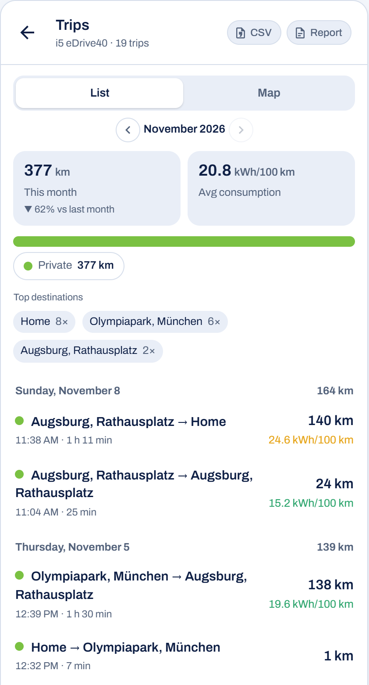
</p>

---

## Kleine Karten und die Garage (`view: glance`, `view: row`, `view: garage`)

<a id="small-cards-and-the-garage-view-glance-view-row-view-garage"></a>

Drei kompakte Karten für den ersten Bildschirm eines Dashboards. Sie lesen das
Auto genau wie die Übersicht: derselbe Ladestand (oder Tank), dieselbe
Reichweite, dieselbe Zeile oben.

- **`view: glance`**: eine Kachel, halb so breit wie ein Abschnitt, mit dem
  Bild des Autos, Ladestand und Reichweite, einem schmalen Balken mit dem Ziel,
  der Zeile oben (*Startklar*, *Lädt · fertig um 05:40*, …) und
  Schloss und Stecker als kleinen Symbolen. Beim Laden steht die Leistung neben
  dem Namen.
- **`view: row`**: dasselbe in einer Zeile: Bild, die Zeile oben, der Name des
  Autos mit den Fakten dahinter, am Ende Ladestand und Reichweite.
- **`view: garage`**: alle Autos aller Konten in einer Karte, je eine Zeile mit
  Bild, Ladestand, Balken, Zeile oben und Reichweite. Sie braucht kein
  `device:`.

Antippen öffnet den Ladestand (oder Tank) des Autos. Mit **Beim Antippen
öffnen** (`navigation_path:`) öffnet sich stattdessen ein anderes Dashboard,
zum Beispiel eines mit dem Hub:

```yaml
type: custom:bavariandata-card
view: glance
navigation_path: /car-hub/0
```

In einem Abschnitte-Dashboard beginnt die Kachel halb so breit wie ein
Abschnitt, sodass zwei Autos nebeneinander passen; jede andere Ansicht füllt
die Breite.

<p align="center">
  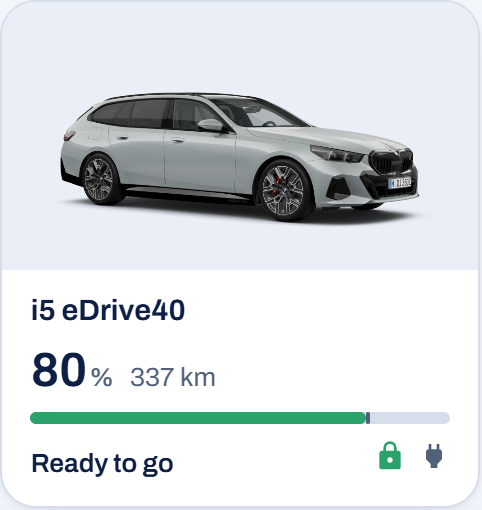
  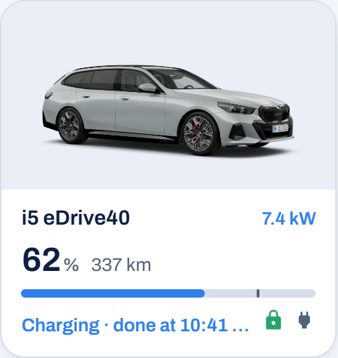
</p>

<p align="center">
  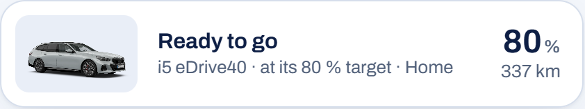
  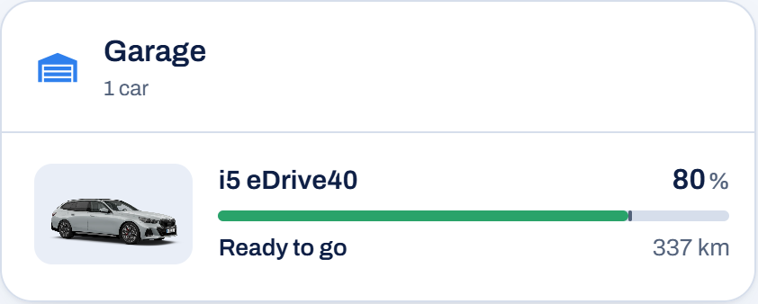
</p>

## Von einer älteren Karte

<a id="coming-from-an-older-card"></a>

Jede Karte, die du schon hast, funktioniert weiter, mit demselben YAML, im neuen
Aussehen.

| Deine Karte | Jetzt |
| --- | --- |
| `type: custom:bavariandata-card` | Die Übersicht: Zeile oben, Balken, Kacheln, die dem Auto folgen. Bereiche nur mit `hub: true`. |
| `tiles: […]` | Deine Kacheln, in jeder Lage. |
| `drivetrain:`, `device:`, `vin:`, die Entitäts-Überschreibungen | Unverändert. |
| `view: charging` · `trips` · `efficiency` · `fuel` | Dieselbe Ansicht, neu gezeichnet. |
| `view: map` | Unverändert; die Fahrten-Ansicht öffnet sie auch im Reiter Karte. |
| `view: health` · `mileage` · `equipment`, `cluster: …` | Unverändert; Batteriezustand und Kilometer sind zusätzlich je eine Zeile in `view: car`. |
| `custom:bmw-cardata-card` | Funktioniert weiter. |

Neu: `hub: true`, `view: car`, `view: glance`, `view: row`, `view: garage`.

---

## Vollständige YAML-Referenz

<a id="full-yaml-reference"></a>

| Schlüssel | Zweck |
| --- | --- |
| `type` | Immer `custom:bavariandata-card`. |
| `view` | `charging`, `trips`, `map`, `health`, `efficiency`, `mileage`, `fuel`, `equipment`, `car`, `glance`, `row` oder `garage`. Weglassen für die Übersicht. |
| `cluster` | `electric`, `status`, `tire`, `usage`, `events`, `basic`, `contract`, `metadata`, `other`, `closures`. Zeigt die Liste einer Datengruppe (oder die besonderen Diagramme für Reifen und Öffnungen). |
| `device` | Geräte-ID, um ein bestimmtes Fahrzeug festzulegen. Der visuelle Editor listet nur deine Fahrzeuge, nie das Diagnose-Gerät des Kontos (*BMW CarData*); eine Karte, die darauf eingestellt ist, zeigt stattdessen das erste Fahrzeug. |
| `vin` | FIN, als Alternative zu `device`. |
| `title` | Überschreibt den Titel der Karte. |
| `image` | Überschreibt die Bild-Entität des Fahrzeugs. |
| `soc` | Überschreibt die Ladezustands-Entität. |
| `range` | Überschreibt die Reichweiten-Entität. |
| `charging` | Überschreibt die Ladestatus-Entität. |
| `target_soc` | Überschreibt die Ladeziel-Entität. |
| `time_to_full` | Überschreibt die Entität „Bis voll“. |
| `odometer` | Überschreibt die Kilometerstand-Entität. |
| `plug` | Überschreibt die Steckerstatus-Entität. |
| `drivetrain` | `bev`, `phev` oder `ice` — das Layout der Übersicht. Weglassen, um es aus den gestreamten Daten zu erkennen. |
| `tiles` | Die Kacheln der Übersicht, in Reihenfolge: fertige Kacheln (`odometer`, `tank`, `total_range`, `target`, `plug`, `time_to_full`, `tires`, `location`, `lock`, `distance_month`, `battery_12v`), Entitäts-IDs oder `{entity, name, icon}`. Weglassen für die des Antriebs. Siehe [Kacheln wählen](#choosing-the-tiles). |
| `steering` | `left` oder `right` — auf welcher Seite der Fahrer sitzt; danach ordnet die Öffnungs-Ansicht Türen und Fenster zu. Weglassen, um es aus BMWs Fahrzeugbasisdaten zu lesen; ein Auto, dessen Basisdaten nichts dazu sagen, wird als Linkslenker gezeichnet. |
| `shape` | `sedan` oder `countryman` — das Auto, das die Reifen- und die Öffnungs-Ansicht zeichnen. Weglassen, um es anhand des Modells in BMWs Fahrzeugbasisdaten zu wählen. |
| `pictures` | `false` — die Ansicht Ausstattung als reine Liste, ohne die Bilder der Optionen (**Bilder der Optionen zeigen** im visuellen Editor). Weglassen, um sie zu zeigen. |
| `fuel` | Überschreibt die Tank-Entität (Prozent oder Volumen). |
| `hub` | `true`: die Übersicht mit den Bereichen darunter (**Bereiche unter der Übersicht**). Siehe [Der Hub](#the-hub-hub-true). |
| `navigation_path` | Ein Dashboard-Pfad, den die Karten `glance`, `row` und `garage` beim Antippen öffnen (**Beim Antippen öffnen**). Weglassen, um Ladestand oder Tank des Autos zu öffnen. |

Mit installierter Integration braucht man Entitäts-Überschreibungen selten — die Karte
findet sie über das Gerät des Fahrzeugs. Nutze sie nur, wenn du Entitäten umbenannt
hast oder die Karte auf einen Helfer zeigen soll.

---

> **Sieht das an deinem Auto richtig aus?** Ein Screenshot der Karte an deinem
> Modell ist das Nützlichste, was du schicken kannst — besonders, wenn eine Ansicht leer bleibt, ein Wert falsch aussieht oder eine
> erwartete Datengruppe fehlt.
> [Poste ihn in den Discussions →](https://github.com/JustChr/BavarianData/discussions)
